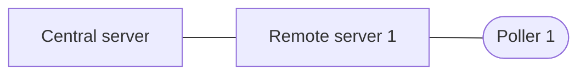

# Docs @ Centreon
Welcome to the repo for our documentation. This is the source for	
[https://docs.centreon.com/](https://docs.centreon.com/).	

Feel free to send us pull requests and file issues. Our docs are completely	
open source and we deeply appreciate contributions from our community!

## Contributing

We value your documentation contributions, and we want to make it as easy
as possible to work in this repository. One of the first things to decide is
which branch to base your work on. If you get confused, just ask and we will
help. If a reviewer realizes you have based your work on the wrong branch, we'll
let you know so that you can rebase it.

To understand how the documentation is structured, you may have a look to the
 [Docusaurus project](https://docusaurus.io/).
We're using version 2.

### Pull request guidelines

Help us review your PRs more quickly by following these guidelines.

* Try not to touch a large number of files in a single PR if possible.

* Don't change whitespace or line wrapping in parts of a file you are not editing for other reasons. Make sure your text editor is not configured to automatically reformat the whole file when saving.


### Style guide

Try not to have lines over 80 characters. Use your best judgment, and try to follow the example 
set by the existing documentation.

### Diagrams

Draw diagrams as Mermaid code blocks rather than images: they can be reviewed
and translated like text, they follow the light and dark themes, and their
content stays readable by search engines and LLMs (the llms.txt export
writes them as `mermaid` code blocks).

````md

````

* Give each node a class instead of colors: `central`, `remote`, `poller`,
  `database`, `question`, `answer` or `muted`. Colors are set once for all
  diagrams in `src/css/mermaid.css`.
* Describe the diagram with `accTitle` and `accDescr`: screen readers read them.
* Use readable node IDs (`central`, `remote1`), and keep the same IDs and
  structure in the English and French versions: only labels are translated.
* Prefer `flowchart LR` when a diagram has many nodes on one level: the page
  column is narrow.
* Preview diagrams with the [Mermaid live editor](https://mermaid.live).
