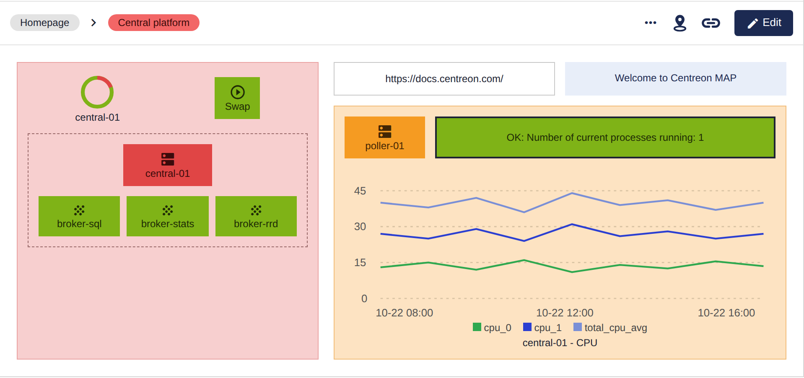

Centreon MAP lets you create, view and share graphical representations of your monitored infrastructure, directly in the Centreon web interface.

## Overview

Create, customize, and display your maps within a single web interface.

First, create your maps in the MAP editor:

Then display your map in viewing mode:

Your maps can be displayed in two ways in the interface:
- On the **Monitoring > Map** page, in viewing mode.
- On the **Home > Custom Views** page, using a dedicated MAP [widget](../alerts-notifications/custom-views.md).

## Procedures

The following topics explain how to use and administer Centreon MAP.

- [Manage access rights in MAP](map-web-access.md) describes the various rights and permissions on maps.
- [Manage maps in MAP](map-web-manage.md) explains how to manage maps from the Centreon MAP interface.
- [Create a standard map](map-web-create-standard-map.md) describes how to create standard maps and how to customize them using the MAP editor.
- [Create a geographic view](map-web-create-geoview.md) explains how to display your resources across a defined geographical area.
- [MAP known issues](map-web-known-issues.md) lists issues you may encounter when using MAP.
