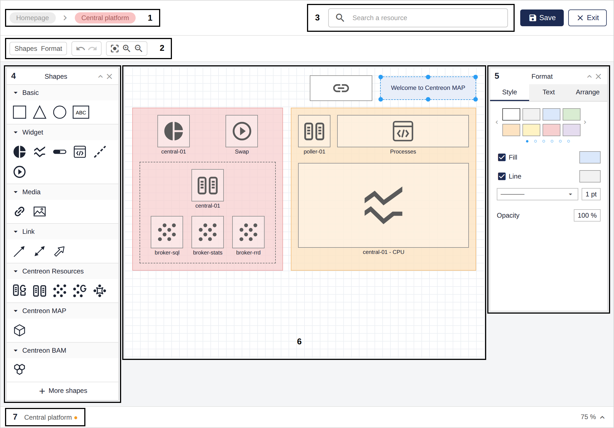

This topic describes how to create standard maps and how to customize them using the MAP editor.

If you see the **Add a Map** button on the **Monitoring > Map** page, you belong to an access group that is granted the creator role, and you can create maps.

## Create a standard map

1. On the **Monitoring > Map** page, click the **Add a Map** button located in the **Standard maps** section.

2. Fill in the properties of the new map:
   - Name: enter a name for the map.
   - Geo coordinates: fill in the fields in the `Latitude, Longitude` format. This allows the map to be added to a [geographic view](./map-web-create-geoview.md).
   - Image: select an image if you want to customize the map's display in the list of maps.

3. Click **Add** to confirm the map's creation.

The new map opens directly in the editor interface.

## Create a map from an existing container

You can create a map directly from a [container](#container). This is useful when you want to share one level of a map with other users without duplicating its content or granting full access to the main map.

1. Right-click the container and click **Create map from container**.
2. Name the container.
3. Click **Add**.

Your map has been created. You can find it on the **Map** page.

> Now you can customize your map using the MAP editor features.

## Use the MAP editor

Follow this procedure to open your map in editing mode:

1. Go to **Monitoring > Map** to display the list of existing maps.
2. Select the map you want to edit.
3. Click the **Edit** button to open it in editing mode.

> When you have finished editing the map, click **Save** to switch to viewing mode. Then click **Exit**.

### MAP editor overview

This is the MAP editor:

**1. Breadcrumb:** shows where you are in the map, when the map has several levels.
**2. Toolbar:** lets you show or hide panels, undo or redo actions, and fit, zoom in or zoom out on the drawing canvas.
**3. IP address:** this is the MAP server address specified in the Centreon MAP settings.
**4. Shapes panel:** this panel offers all elements you need to build a map, from the basics to the Centreon resources.
**5. Format panel:** this panel allows you to apply a format to a selected element.
**6. Drawing canvas:** this is the space in the middle of the editor, where you draw your diagram.
**7. Tabs:** let you navigate between the levels of your map. Each container has its own tab.

### Use graphical elements to build your map

The **Shapes** panel contains different types of elements to build your map. Options are displayed depending on the type of element you have selected.

#### Basic elements

Use **Basic** shapes to organize your map elements with geometric shapes and text areas. Then use the **Format** panel to customize your shape by applying a style format such as color, opacity, etc.

#### Widget elements

Use **Widget** elements to display graphical data about the resources you monitor. Widgets provide information such as health status or performance metrics. The available widgets are:
- **Pie chart:** displays the status of a resource as proportions. It displays:
  - For a host: the number of OK, Warning, Critical, and NA statuses.
  - For a host group: the number of hosts in OK, Warning, Critical, and NA statuses.
- **Line chart:** displays performance data related to a service, over a period of time.
- **Gauge:** displays a metric as a percentage. You must set a maximum value. You can place a gauge in any direction (left to right, bottom to top, etc.).
- **Output:** displays the output of a service. The background is in the same color as the status.
- **Process:** allows you to trigger an action on any resource based on a command. Here is an example:
  - You have an internal website that uses Apache, and sometimes Apache crashes. You need to find the root cause of the crash, but your priority is to keep the website available to end users.
  - You can use the process widget by assigning a command such as `service httpd restart`, so that when the Apache process crashes, users can immediately restart the Apache service from the map by double-clicking the widget.
  - To create a service dedicated to an "action": go to **Configuration > Commands > Checks**, click **Add** and create a command that contains `service httpd restart` (remember to enable shell). Link the command to a passive service. Link the passive service to a host (e.g., the host that hosts the website). Then you can assign that service to the widget.

#### Media elements

Use **Media** elements to add:
- **URL:** adds a clickable link.
- **Image:** allows you to customize your diagram by adding images.

1. Drag and drop the element onto the drawing canvas.
2. Right-click it and select **Edit data**.
3. Fill in the required setting and click **Submit**.

#### Link elements

Use **Link** elements to make connections between items (with anchor points):
- **Link:** a simple arrow that connects two items.
- **Status link:** use this link between two items and configure a resource to monitor from it. The link then takes the color of the status of the selected resource.
- **Metric link:** use this link between two items and configure a service and its metrics from it. The link then displays the metrics of the selected service.

#### Centreon elements

- **Resources** elements:
  - Host group
  - Host
  - Service
  - Service group
  - Metaservice

- **MAP** element:
  - [Container](#container)

- **BAM** elements:
  - Business activity

##### Container

Use containers when you want to create multiple levels of your map. Each level is represented by a container.
- In viewing mode, each container becomes a map with its own status.
- In editing mode, each level becomes a tab. You can then navigate between containers using the different tabs.

Settings are displayed depending on the type of element you have selected.

1. Drag and drop the element onto the drawing canvas.
2. Right-click it and select **Edit data**.
3. Fill in the required settings and click **Submit**.

#### Customize your elements

The **Format** panel allows you to apply formatting options depending on the type of element you have selected.
- **Style tab:** to customize shapes, links and text.
- **Text tab:** to format all text elements.
- **Arrange tab:** to organize elements on the drawing canvas (size, position, alignment) and arrange them on different layers.

### Add several resources at once

In editing mode, you can add several resources to your map in a single action.

1. Click in the **Search a resource** bar above the drawing canvas.
2. In the dropdown list, select the resources you want in **Host groups, Hosts, Service groups, Services, Metaservices and Business Activities**.
3. Click the **Add to map** button.

The selected resources are added to the map.

## Save the perspective of your map

Save the perspective (zoom and position) of your map so that it always opens the same way. This is useful for wall screens.

- **In editing mode:** the perspective is saved as soon as you click the **Save** button.
- **In viewing mode:** click the **Save perspective** button. A message confirms that the perspective is saved.

> You can add an element and save the map even if the element is not linked to a resource. The element is then displayed in yellow in viewing mode.
