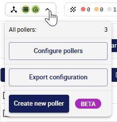

> The following feature is in beta.

A tailored command for installing a poller on a virtual or physical machine can be generated from the central server interface.

## Prerequisites

* The machine on which you will install the poller must fulfill the [poller installation prerequisites](./prerequisites.md).
* You must have a poller-type authentication token (Cloud platforms have a default one, called **poller-default**).

## Step 1: generate the installation command

1. In the interface of the central server, click the **Pollers** area at the top left. Then, click on **Create new poller**.

   

2. Fill in the form with your poller's information:

   * **Poller name**: a unique name for this poller. It will appear in the list of pollers.
   * **Poller address**: the address of the host machine where you are going to install the poller.
      > The **Poller address** does not affect connectivity: Gorgone uses
      > PullWSS, so the poller always initiates the connection to the central
      > server, not the other way around.

3. Select **VM or physical** as the poller's environment.

4. Select your [authentication token](#prerequisites).

5. In the **Generate installation command** section, click the button and wait for the command to be generated.

6. Copy the command using the button at the top right of the code block and execute it on your host machine.

7. Click **Export configuration**. The poller appears in the list of pollers.

## Advanced deployment scenario: using a private repository

If you cannot connect to the Centreon public repository, you can disable automatic installation from this repository and manage package installation in another way.

1. Prepare the OS so that it can find the necessary packages using another channel. For your information, the necessary repositories can be found in the
[Centreon OnPrem documentation](/docs/installation/installation-of-a-central-server/using-packages#install-the-repositories).

2. Follow the procedure above, but before running the installation command that you copied from the interface, edit it and add the `--private-repo` option after the `install` command.
