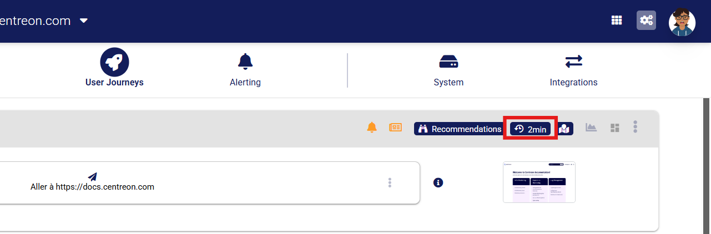

In an STM zone, probes run as Docker containers on your own machine.
A container without limits uses whatever processing power is free at the time, so its performance, and therefore the probe results, varies with the machine's usqage.
Setting CPU and memory limits makes each run happen in the same conditions.

This topic explains how to calculate the adequate limits to run the probes as there is no universal value for this.
The values are also different depending on whether you will be running an STM probe or a recommendations probe.

To establish these limits, Docker has two options: `--cpus` and `--memory`. Both must be written before the image name on the command line.
We also recommend using `--memory-swap` and set it as the same value as `--memory`. This prevents the container from using disk space as memory.
Note that it must be set at the same value as `--memory` to prevent this. Setting it to 0 does not disable this option.

```shell
docker run -d \
  --cpus="<COMPUTED_VALUE>" \
  --memory="2g" --memory-swap="2g" \
  --restart unless-stopped \
  <PROBE_IMAGE> \
  --auth-token <AUTH_TOKEN> \
  --zone-id <ZONE_ID> \
  --run-mode stm
```

To get timings you can compare with those of Centreon-hosted probes, give each container the same resources as those probes:

- Processor: about 620 MHz per container.
- Memory: 2 GB per container.

These values are a baseline.
The sections below explain how to convert them into Docker options for your machine.
Fine-tune them only if your probe results are often unstable.

## Computing for an STM probe

To get a starting value for --cpus, divide 620 MHz by the sustained clock speed of the machine's processor.
The sustained speed is neither the maximum speed printed on the box nor the idle speed.
On Linux, run the following command to see it:

```shell
watch grep MHz /proc/cpuinfo
```

| Processor sustained clock speed   | --cpus to use     |
| --------------------------------- | ----------------- |
| 2.4 GHz (a slower server)         | 620 / 2400 = 0.26 |
| 3.1 GHz (same as a public zone)   | 620 / 3100 = 0.20 |
| 3.6 GHz (a workstation)           | 620 / 3600 = 0.17 |
| 4.5 GHz (a fast desktop)          | 620 / 4500 = 0.14 |

This is only a starting point: the idea of setting a limit is that the container actually reaches it, otherwise it is the same as if it had no limit at all.
Let the probe run a few journeys. Then, run the following command to see how many times the container was throttled (paused because it reached its limit):

```shell
docker exec <container> cat /sys/fs/cgroup/cpu.stat
```

This will return the `nr_throttled` counter which must be greater than zero to confirm the container is reaching its limit.
If the counter shows zero, gradually reduce the number of CPUs.

As a reminder, we recommend also setting `--memory-swap` with the same value you established for `--memory`

## Computing for a recommendations probe

For the recommendations probe, you want the opposite of the STM probe: this probe should never reach its container's limits.
This is because the recommendations probe runs Google Lighthouse audits which intentionally slow down the probe to simulate browsing from different devices.
You still need to set limits so that other activity on the machine does not affect the results

```shell
docker run -d \
  --cpus="2" \
  --memory="4g" --memory-swap="4g" \
  --restart unless-stopped \
  <PROBE_IMAGE> \
  --auth-token <AUTH_TOKEN> \
  --zone-id <ZONE_ID> \
  --run-mode recommendations
```

For reference, in public zones, recommendations probes use two 3.1 GHz logical CPUs with no limit.
If you set --cpus, use a value of at least 2.

Check the number of times the container had to pause using the command shown previously:

```shell
docker exec <container> cat /sys/fs/cgroup/cpu.stat
```

For recommendations probes, the `nr_throttled` counter should always be at 0.

## Capacity planning

Each container runs one journey at a time.
If a zone has more journeys to run than its containers can handle, the runs that do not fit are not queued for later not skipped.
This will result in the journey's graph showing gaps or irregularly spaced points.
This is because the results arrive later than Experience Monitoring expects, so the graph shows them as missing data.

If you see this, your STM zone needs more containers, or fewer runs.

> We recommend having at least two containers per zone, even if the monitored user journey is short so one is always available if the other needs to restart or update.

### How containers share the work

- Every 60 seconds, each container asks the platform for one journey to run in its zone.
- The container runs the journey to the end and sends the result before asking for the next one. A journey that takes more than a minute delays the container's next request.
- A journey that was delayed is not skipped but queued and the platform always gives out the most overdue journey of the zone first.

To add a container to a zone, run the same `docker run` command again.
Each container works independently. There is nothing else to configure.

### Calculating the number of containers for the STM probe

For each journey of the zone, you need two values:

- **The polling interval**: how often the journey should run, as set in the journey's settings (1, 2, 3, 6, 12, 24 or 60 minutes, 2 minutes by default). 
Your plan may impose a minimum interval.
  
  

- **The run duration**: the journey duration which can be found in the Docker logs. Add 10 seconds to this number to account for container startup time.

Then:

1. For each journey, take its run duration, or 60 seconds if the journey is shorter. A container never asks for work more than once a minute, so even a short journey keeps it busy for a full minute.
2. Divide this value by the polling interval in seconds. The result is the share of a container that the journey uses.
3. Add up the results for all the journeys of the zone. This is the load of the zone.
4. Divide the load by 0.7 and round up. This gives you the number of containers, with 30% spare capacity so that the zone can catch up when several journeys are due at the same time.

For example, for a zone with the following journeys:

| Journeys                 | Polling interval | Run duration | Time a container is busy (step 1) | Load (step 2)    |
| ------------------------ | ---------------- | ------------ | --------------------------------- | ---------------- |
| 10 short journeys        | 60 s             | 20 s         | 60 s                              | 10 × 1.00 = 10.0 |
| 20 medium journeys       | 120 s            | 45 s         | 60 s                              | 20 × 0.50 = 10.0 |
| 5 long checkout journeys | 360 s            | 150 s        | 150 s                             | 5 × 0.42 = 2.1   |
| **Load of the zone**     |                  |              |                                   | **22.1**         |

The zone needs 22.1 / 0.7 = 31.6, rounded up to **32 containers**.

### Reducing the number of containers needed

In the example above, the ten journeys that run every minute make up almost half of the load: a journey that runs every minute keeps a container busy all the time. Before adding machines, consider the following:

- **Increase the polling interval** of the journeys that do not need to run every minute. Going from 1 to 2 minutes halves the load of a journey. In the example, running the ten short journeys every 2 minutes brings the load down to 17.1, and the number of containers down to 25.
- **Shorten long journeys, or split them in two.** A 150-second journey keeps a container busy for two and a half minutes at each run.
- **Split the zone.** Journeys that only need to run from a specific network can be moved to a smaller, dedicated zone with its own containers.
