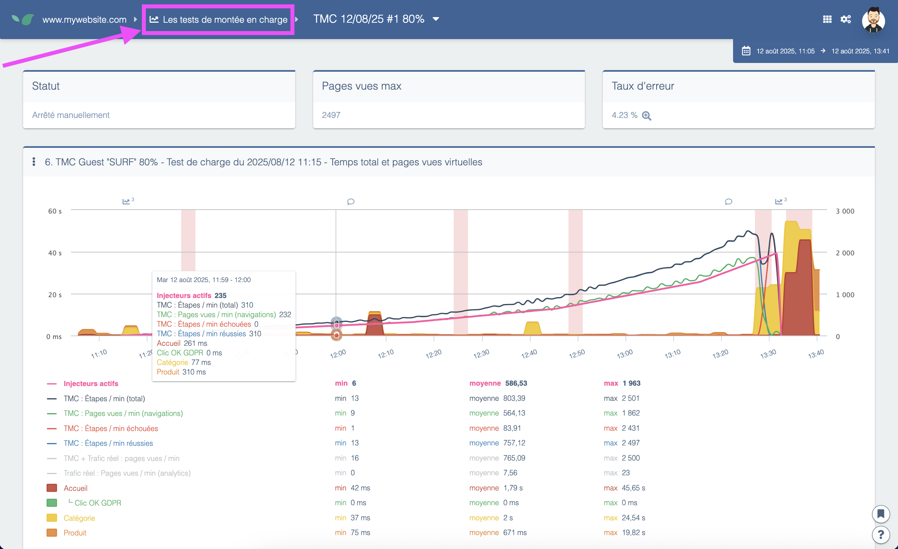

---
id: load-tests
title: Load tests
description: "Load tests simulate heavy traffic on your website to see how it handles many users and find bottlenecks. Beware of the impact on production sites."
---

**Load Tests** create heavy traffic on your site to evaluate its response.
This helps you see how your site manages a big number of users and identify bottlenecks on your site.

>Note that load tests generate real traffic on the website, thus impacting live users if performed on a production website. Load tests can also be performed in test environments.

See our [dedicated article](../how-to-articles/performing-load-tests.md) to learn more about this module.

