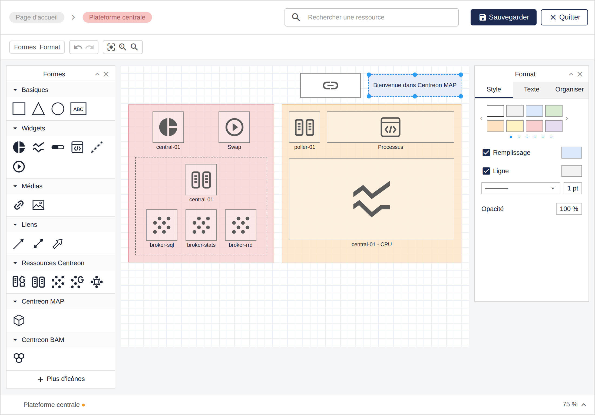
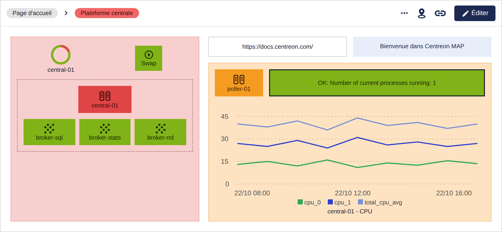

Centreon MAP vous permet de créer, visualiser et partager des représentations graphiques de votre infrastructure supervisée, directement dans l'interface web Centreon.

## Aperçu de l'interface

Créez, personnalisez et visualisez vos cartes au sein d'une unique interface web.

Commencez par créer vos cartes dans l'éditeur MAP :

Visualisez ensuite votre carte en mode visualisation :

Vos cartes peuvent être affichées de deux façons dans l'interface :
- À la page **Supervision > Map**, en mode visualisation.
- À la page **Accueil > Vues personnalisées**, à l'aide d'un [widget](../alerts-notifications/custom-views.md) MAP dédié.

## Procédures

Les procédures suivantes permettent de gérer et d'utiliser Centreon MAP.

- [Gérer les droits d'accès dans MAP](map-web-access.md) décrit les différents droits et permissions sur les cartes.
- [Gérer les cartes dans MAP](map-web-manage.md) explique comment gérer les cartes à partir de l'interface Centreon MAP.
- [Créer une carte standard](map-web-create-standard-map.md) décrit comment créer des cartes standard et comment les personnaliser à l'aide de l'éditeur MAP.
- [Créer une vue géographique](map-web-create-geoview.md) explique comment afficher vos ressources dans une zone géographique définie.
- [Bonnes pratiques pour utiliser les cartes](map-best-practices.md) donne des conseils pour créer des cartes claires et faciles à maintenir.
- [Problèmes connus dans MAP](map-web-known-issues.md) répertorie les problèmes que vous pouvez rencontrer en utilisant MAP.
