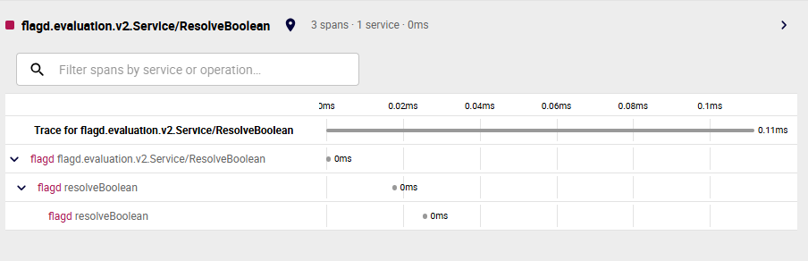

## Qu'est-ce qu'une trace ?

Lorsqu'une action a lieu dans une application, par exemple quand un utilisateur clique sur un bouton, elle déclenche souvent toute une série d'opérations en coulisses, réparties sur plusieurs services. Une trace enregistre l'intégralité de ce parcours, du début à la fin.

Chaque étape du parcours, comme une requête à une base de données ou un appel à un autre service, s'appelle un span. Tous les spans d'un même parcours partagent un identifiant, le **trace_id**, qui les relie en une seule trace, même lorsque les étapes s'exécutent dans des services différents.

Une trace vous montre ce qui s'est passé, à quel endroit et combien de temps chaque étape a pris. Lorsqu'une requête est lente ou échoue, la trace vous indique où le temps a été perdu et à quel endroit le problème est survenu.

Les traces sont listées dans la page **Trace explorer**, où vous pouvez filtrer et rechercher des données [comme dans Log explorer](../log-explorer.md#rechercher-des-logs).

## Qu'est-ce qu'un span ?

Un span représente l'exécution d'une opération précise au sein d'une trace : une requête à une base de données, un appel à un autre service, un calcul, etc. Chaque span possède :

* un nom
* un horodatage de début et de fin, qui permet de calculer sa durée
* un identifiant propre, le **span_id**
* le **trace_id** de la trace à laquelle il appartient.

Les spans d'une trace sont organisés selon une relation parent-enfant : un span peut en déclencher un autre, par exemple lorsqu'un service en appelle un second. Chaque span enfant porte le spanId de son parent dans le champ parentSpanId. Ces liens permettent de reconstituer l'enchaînement complet des opérations et d'identifier précisément où un ralentissement ou une erreur s'est produit.

Le span qui n'a pas de parent est appelé span racine : c'est celui qui démarre la trace.

## La vue en cascade d'une trace

Les traces sont généralement affichées sous forme de vue en cascade (waterfall) : chaque barre représente un span, sa longueur correspond à sa durée, et les spans enfants apparaissent en retrait sous leur parent. Voici à quoi ressemble la vue en cascade d'une trace dans Log Management :



## Une trace correspond-elle toujours à une requête ?

Une requête est une demande faite au système : un clic, un chargement de page, un appel d'API. Le plus souvent, une requête correspond à une trace, mais pas toujours.

Prenons un exemple : un utilisateur ouvre une page de boutique en ligne. Le chargement de cette page déclenche toute une chaîne d'actions en coulisses. Le serveur reçoit la demande, va chercher les informations de l'utilisateur dans une base de données, interroge un service pour récupérer le catalogue de produits, puis un autre pour le panier, et assemble enfin le tout pour renvoyer la page. Si la page met 3 secondes à s'afficher, la trace de cette requête montre le temps passé à chaque étape.

C'est le cas le plus courant : un utilisateur fait une demande, le système la traite et répond. Une requête, une trace.

Cependant, une trace suit une opération, pas une requête : elle peut inclure des tâches exécutées plus tard, comme l'envoi d'un e-mail de confirmation après une commande, et une seule requête peut être coupée en plusieurs traces si un service ne transmet pas le contexte de trace (voir [Propagation du contexte](#propagation-du-contexte)).

## Différence entre une trace et un log de sévérité TRACE

Malgré leur nom, ces deux notions n'ont aucun rapport. TRACE est le niveau de sévérité le plus détaillé d'un log, en dessous de DEBUG : il sert à enregistrer des informations très fines sur l'exécution du code. Une trace, au sens de l'observabilité, est l'enregistrement du parcours d'une opération à travers plusieurs services.

Un log de sévérité TRACE ne fait donc pas partie d'une trace, et un log de n'importe quelle sévérité peut être relié à une trace.

## Corrélation entre traces et logs

Un enregistrement de log contient des champs facultatifs **TraceId** et **SpanId**, renseignés à partir du contexte actif au moment où le log est émis. C'est grâce à ces champs que Log Management peut vous afficher « les logs émis pendant ce span » : passez [des logs aux traces](exploring.md#passer-dun-log-à-sa-trace) et [des traces aux logs](exploring.md#passer-dune-trace-aux-logs-associés).

## Exemple : un span parent et son span enfant

Dans cet exemple, un service reçoit une commande (**process_order**), puis appelle un service de paiement (**charge_payment**).

Les exemples ci-dessous suivent le format OTLP/JSON d'OpenTelemetry, légèrement simplifié pour la lisibilité : les valeurs de **kind** et de **status.code** sont indiquées par leur nom plutôt que par leur valeur numérique.

### Span parent

```json
{
  "traceId": "5b8aa5a2d2c872e8321cf37308d69df2",
  "spanId": "051581bf3cb55c10",
  "name": "process_order",
  "kind": "SPAN_KIND_SERVER",
  "startTimeUnixNano": "1657891199950000000",
  "endTimeUnixNano": "1657891200400000000",
  "attributes": [
    { "key": "http.method", "value": { "stringValue": "POST" } },
    { "key": "http.route", "value": { "stringValue": "/api/orders" } },
    { "key": "order.id", "value": { "stringValue": "ORD-48213" } }
  ],
  "status": {
    "code": "STATUS_CODE_OK"
  }
}
```

* **startTimeUnixNano** et **endTimeUnixNano** sont des horodatages en nanosecondes depuis l'epoch Unix. Leur différence donne la durée du span : 450 ms.
* **attributes** contient des métadonnées sous forme de paires clé/valeur typées (méthode HTTP, route, identifiant métier…). Voir [Attributs et ressource](#attributs-et-ressource).
* Ce span parent n'a pas de `parentSpanId` : c'est le span racine de la trace (celui qui la déclenche). S'il était lui-même déclenché par un autre span (par exemple côté navigateur ou passerelle API), il porterait le **spanId** de ce dernier dans **parentSpanId**.

### Span enfant

```json
{
  "traceId": "5b8aa5a2d2c872e8321cf37308d69df2",
  "spanId": "051581bf3cb55c13",
  "parentSpanId": "051581bf3cb55c10",
  "name": "charge_payment",
  "kind": "SPAN_KIND_CLIENT",
  "startTimeUnixNano": "1657891200000000000",
  "endTimeUnixNano": "1657891200340000000",
  "attributes": [
    { "key": "http.method", "value": { "stringValue": "POST" } },
    { "key": "http.url", "value": { "stringValue": "https://payment-service/api/charge" } },
    { "key": "http.status_code", "value": { "intValue": "200" } }
  ],
  "status": {
    "code": "STATUS_CODE_OK"
  }
}
```

* **parentSpanId** contient le spanId du span process_order : c'est ce qui en fait son enfant.

### Ce qui relie les deux spans

* Les deux spans ont le même **traceId** (**5b8aa5a2d2c872e8321cf37308d69df2**) : ils appartiennent à la même trace.
* Le **parentSpanId** de **charge_payment** est égal au **spanId** de **process_order** (**051581bf3cb55c10**). C'est ce lien qui permet à l'outil de visualisation de reconstruire l'arbre :

    ```text
    process_order (051581bf3cb55c10)          [SERVER, 450 ms]
    └── charge_payment (051581bf3cb55c13)    [CLIENT, 340 ms]
    ```

* La plage temporelle du parent englobe celle de l'enfant : **charge_payment** démarre 50 ms après **process_order** et dure 340 ms. C'est le cas habituel pour un appel synchrone. Dans un traitement asynchrone (file de messages, tâche différée), un span enfant peut en revanche se terminer après son parent.

## Attributs et ressource

Les **attributs** d'un span sont des paires clé/valeur qui décrivent l'opération : méthode HTTP, route appelée, code de réponse, requête SQL, identifiant de commande, etc. OpenTelemetry définit des noms standard pour les attributs les plus courants (les **conventions sémantiques**), par exemple `http.request.method` ou `http.response.status_code`. Vous pouvez aussi ajouter vos propres attributs métier, comme `order.id` dans l'exemple ci-dessus.

La **ressource** décrit l'entité qui a produit le span : le service, sa version, l'hôte ou le conteneur sur lequel il s'exécute. Ses attributs, comme `service.name` ou `host.name`, sont communs à tous les spans émis par ce service.

Les attributs et la ressource sont ce qui permet de filtrer, regrouper et analyser les traces : par exemple, afficher toutes les traces d'un service donné, ou toutes les requêtes ayant renvoyé une erreur 500.

## Statut d'un span

Chaque span porte un statut qui indique si l'opération a réussi :

* `UNSET` : valeur par défaut, aucun statut n'a été défini explicitement. L'opération est considérée comme réussie.
* `OK` : l'opération a été explicitement marquée comme réussie.
* `ERROR` : l'opération a échoué.

Le statut permet de repérer rapidement les spans en erreur dans une trace, et donc de localiser l'étape où un problème est apparu.

## Propagation du contexte

Pour que les spans émis par différents services soient reliés à la même trace, le `traceId` et le `spanId` du span en cours doivent être transmis d'un service à l'autre. C'est ce qu'on appelle la **propagation du contexte**.

Lors d'un appel HTTP, ce contexte est transmis dans l'en-tête `traceparent`, défini par le standard W3C Trace Context :

```text
traceparent: 00-5b8aa5a2d2c872e8321cf37308d69df2-051581bf3cb55c13-01
```

Cet en-tête contient la version du format, le `traceId`, le `spanId` du span appelant et des indicateurs (par exemple, si la trace est échantillonnée). Le service appelé lit cet en-tête et crée ses propres spans avec le même `traceId`, en utilisant le `spanId` reçu comme `parentSpanId`.

Les SDK OpenTelemetry gèrent cette propagation automatiquement pour la plupart des bibliothèques HTTP, gRPC et de messagerie. Si un service de la chaîne n'est pas instrumenté ou ne transmet pas le contexte, la trace est coupée en plusieurs morceaux.
