import Tabs from '@theme/Tabs';
import TabItem from '@theme/TabItem';

## Prérequis

### Centreon Monitoring Connector Manager

Le module **Centreon Monitoring Connector Manager** permet d'installer, de mettre à jour ou de supprimer des connecteurs. Il est installé par défaut. Nous vous recommandons de le mettre à jour régulièrement.

Pour mettre à jour ce module, exécutez la commande suivante :

<Tabs groupId="sync">
<TabItem value="Alma / RHEL / Oracle Linux 8, 9 & 10" label="Alma / RHEL / Oracle Linux 8, 9 & 10">

```shell
dnf update centreon-pp-manager
```

</TabItem>
<TabItem value="Debian 12 & 13" label="Debian 12 & 13">

```shell
apt install --only-upgrade centreon-pp-manager
```

</TabItem>
</Tabs>

### Licence

Une [licence](./integrations/plugin-packs/getting-started/how-to-guides/connectors-licenses.md) est nécessaire pour accéder à l'ensemble du catalogue des connecteurs de supervision. Contactez l'[équipe support de Centreon](https://support.centreon.com) pour obtenir votre licence.

### Connecteurs

Certains connecteurs de supervision nécessitent aussi un connecteur (par exemple AS400 ou VMware) ou un agent (par exemple Windows NRPE). Dans ce cas, la procédure de supervision du connecteur de supervision l'indique. Ces connecteurs sont inclus dans la licence des connecteurs de supervision.

| Connecteur | Description                                                                                         |
| ---------- | --------------------------------------------------------------------------------------------------- |
| NRPE       | Serveur NRPE, packagé par Centreon, avec les correctifs nécessaires pour fonctionner avec les connecteurs de supervision |
| NSClient++ | NSClient++, packagé par Centreon, prêt à l'emploi avec les plugins Centreon intégrés                |
| VMWare     | Démon Perl qui utilise le SDK VMware pour superviser les plateformes VMware                          |
| AS400      | Connecteur Java qui permet d'exécuter des contrôles sur un AS400                                     |

## Installer un connecteur de supervision

L'installation d'un connecteur de supervision se fait en 4 étapes :

1. Accéder au catalogue des connecteurs de supervision.
2. Installer le pack.
3. Consulter la procédure de supervision.
4. Installer le plugin.

### Accéder au catalogue des connecteurs de supervision

* Si vous avez une [licence](./integrations/plugin-packs/getting-started/how-to-guides/connectors-licenses.md) en ligne, le catalogue des connecteurs de supervision est déjà disponible sur votre plateforme, à la page **Configuration > Connecteurs > Connecteurs de supervision**.

* Si vous avez une licence hors ligne :
    - installez le dépôt des connecteurs de supervision (son adresse est disponible sur le [portail support de Centreon](https://support.centreon.com/hc/en-us/categories/10341239833105-Repositories)) ;
    - installez ou mettez à jour le catalogue des connecteurs de supervision depuis votre serveur central Centreon :

<Tabs groupId="sync">
<TabItem value="Alma / RHEL / Oracle Linux 8, 9 & 10" label="Alma / RHEL / Oracle Linux 8, 9 & 10">

```shell
dnf install centreon-pack-*
```

</TabItem>
<TabItem value="Debian 12 & 13" label="Debian 12 & 13">

```shell
apt install centreon-pack-*
```

</TabItem>
</Tabs>

> Bien que cette commande s'appelle `install`, elle ne fait que rendre les connecteurs de supervision disponibles dans l'interface de Centreon. Elle n'installe pas les connecteurs de supervision eux-mêmes. Suivez la suite de la procédure.

### Installer le pack

Vous avez maintenant accès au catalogue des connecteurs de supervision, à la page **Configuration > Connecteurs > Connecteurs de supervision** :

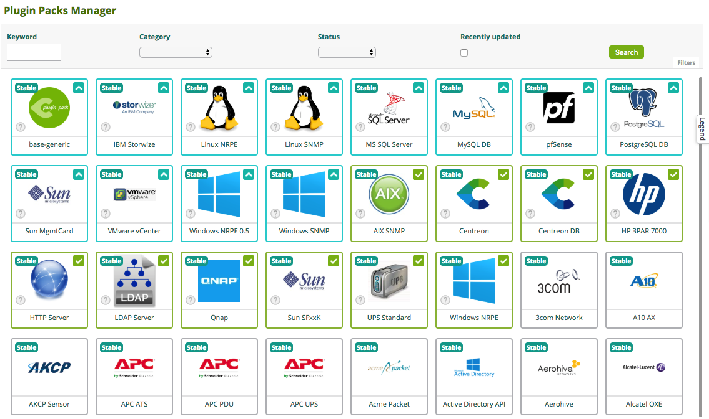

Pour installer un pack, survolez son icône avec la souris et cliquez sur le ``+`` :

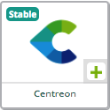

Vous pouvez aussi cliquer sur le connecteur de supervision pour afficher plus de détails, puis cliquer sur le ``+`` :

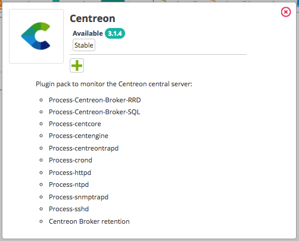

Une fois le pack installé, il est entouré de vert et porte une coche verte.

| **Avant l'installation**                                          | **Après l'installation**                                          |
| ---------------------------------------------------------------- | --------------------------------------------------------------- |
| 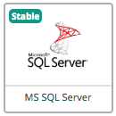 | 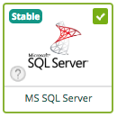 |

### Gérer les dépendances

Pendant l'installation, il peut arriver que certains objets du pack ne soient pas installés. Il s'agit souvent d'objets de configuration supplémentaires, qui ne sont pas nécessaires pour déployer les modèles de configuration fournis par le pack.

La plupart du temps, il faut mettre à jour votre plateforme Centreon, puis réinstaller le pack.

### Consulter la procédure de supervision

Certains connecteurs de supervision demandent des étapes de configuration supplémentaires. Lisez la procédure de supervision de chaque pack installé pour connaître son contenu et ses éventuels prérequis. Cliquez sur l'icône ``i`` de chaque pack pour accéder à sa documentation :

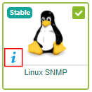

### Installer le plugin

Les plugins peuvent être installés en ligne de commande ou automatiquement.

#### Installation automatique

1. [Installez le pack](#installer-le-pack).
2. [Consultez la procédure de supervision](#consulter-la-procédure-de-supervision) pour connaître les étapes de configuration supplémentaires.
3. À la page **Configuration > Connecteurs > Connecteurs de supervision**, passez **Installation automatique des plugins** à **ON**.
4. Utilisez un modèle fourni par le pack pour superviser un hôte ou un service.
5. [Déployez la configuration](./using-connectors.md#déployer-la-configuration) des collecteurs qui supervisent ces hôtes ou ces services : les plugins correspondants sont installés automatiquement sur ces collecteurs.

#### Installation manuelle

La procédure de supervision contient une section **Installation** qui explique comment installer le plugin (avec une licence en ligne ou hors ligne). Installez le plugin sur chaque collecteur qui exécutera les contrôles du plugin.

La commande d'installation ressemble à ceci :

<Tabs groupId="sync">
<TabItem value="Alma / RHEL / Oracle Linux 8, 9 & 10" label="Alma / RHEL / Oracle Linux 8, 9 & 10">

```shell
dnf install centreon-plugin-$PLUGIN-PACK$
```

</TabItem>
<TabItem value="Debian 12 & 13" label="Debian 12 & 13">

```shell
apt install centreon-plugin-$PLUGIN-PACK$
```

</TabItem>
</Tabs>

Où ``$PLUGIN-PACK$`` est le nom du pack. Exemple :


<Tabs groupId="sync">
<TabItem value="Alma / RHEL / Oracle Linux 8, 9 & 10" label="Alma / RHEL / Oracle Linux 8, 9 & 10">

```shell
dnf install centreon-plugin-Cloud-Aws-Ec2-Api
```

</TabItem>
<TabItem value="Debian 12 & 13" label="Debian 12 & 13">

```shell
apt install centreon-plugin-cloud-aws-ec2-api
```

</TabItem>
</Tabs>

## Mettre à jour les connecteurs de supervision

> Vous devez mettre à jour à la fois le plugin et le pack.

### Mettre à jour un pack ou tous les packs

**Pour mettre à jour un pack :**

Si une flèche apparaît sur un connecteur de supervision, une mise à jour est disponible.

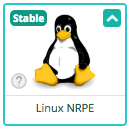

Survolez le connecteur de supervision et cliquez sur la flèche,

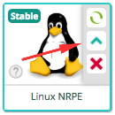

ou cliquez sur le connecteur de supervision pour afficher plus de détails, puis cliquez sur la flèche.

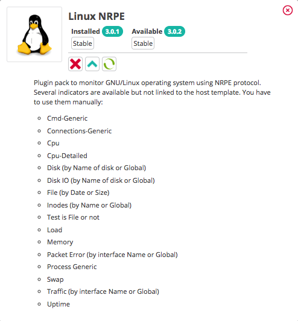

Confirmez la mise à jour.

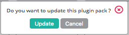

Votre pack est à jour. Vous pouvez maintenant [mettre à jour le plugin](#mettre-à-jour-les-plugins).

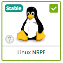

**Pour mettre à jour tous les packs :**

Vous pouvez aussi mettre à jour tous les packs en même temps : lorsque des mises à jour de packs sont disponibles, un bouton **Tout mettre à jour** apparaît.
Vous devrez quand même [mettre à jour les plugins](#mettre-à-jour-les-plugins).

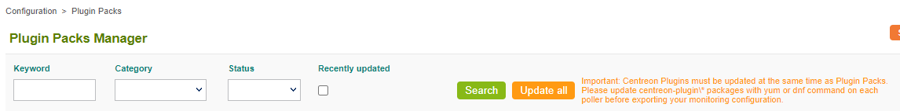

### Mettre à jour les plugins

À la page **Configuration > Connecteurs > Connecteurs de supervision**, si **Installation automatique des plugins** est à **ON**, les plugins sont mis à jour automatiquement lorsque vous déployez la configuration d'un collecteur qui supervise un hôte utilisant ces plugins.

Si **Installation automatique des plugins** est à **OFF**, mettez à jour les plugins de la façon suivante :

1. Exécutez la commande suivante sur tous les collecteurs :

<Tabs groupId="sync">
<TabItem value="Alma / RHEL / Oracle Linux 8, 9 & 10" label="Alma / RHEL / Oracle Linux 8, 9 & 10">

```shell
dnf update centreon-plugin\*
```

</TabItem>
<TabItem value="Debian 12 & 13" label="Debian 12 & 13">

```shell
apt-get --only-upgrade install centreon-plugin\*
```

</TabItem>
</Tabs>

2. [Déployez la configuration](./using-connectors.md#déployer-la-configuration) de tous les collecteurs. L'option **Redémarrer l'ordonnanceur** doit être réglée sur **Redémarrer**.

3. Vérifiez que l'exécution des nouveaux plugins ne génère pas de nouvelles erreurs.

> Vous pouvez choisir d'installer tous les plugins sur chaque collecteur, ou seulement les plugins nécessaires. Gardez à l'esprit que vous pouvez rencontrer des erreurs si vous déplacez un hôte supervisé vers un collecteur sur lequel les plugins nécessaires ne sont pas installés.
> Si vous mettez à jour les plugins sur le serveur central Centreon, pensez à les mettre à jour aussi sur chaque collecteur.

## Désinstaller des connecteurs de supervision

Comme pour l'installation, vous pouvez supprimer un pack en survolant le pack voulu dans l'interface et en cliquant sur la croix rouge :

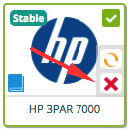

ou en cliquant d'abord sur le pack, puis sur la croix rouge :

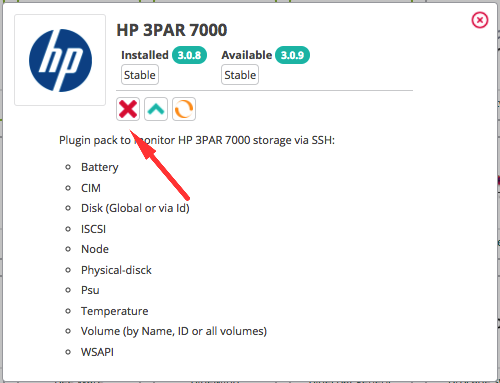

Confirmez la désinstallation.

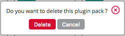

Votre connecteur de supervision est maintenant désinstallé.

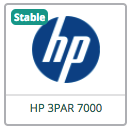

#### Gérer les dépendances

Si des modèles d'hôtes ou de services fournis par le connecteur de supervision sont utilisés par un hôte, un service ou un modèle, le connecteur de supervision ne peut pas être désinstallé.

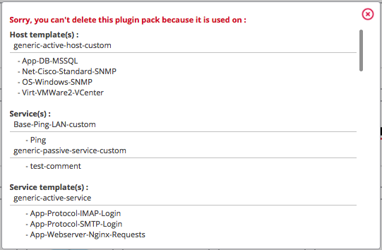

Si le connecteur est utilisé par un hôte ou un service, vous devez, pour le désinstaller :

* soit supprimer les hôtes ou les services liés aux modèles fournis par ce connecteur de supervision ;
* soit délier les hôtes liés aux modèles fournis par ce connecteur de supervision (si c'était le seul modèle d'hôte appliqué à un hôte, celui-ci ne sera plus supervisé).

Si un modèle fourni par le connecteur est utilisé par un autre modèle, vous devez supprimer le lien entre les modèles avant de pouvoir supprimer le connecteur, même si l'autre modèle n'est utilisé par aucun hôte ni service.

Par ailleurs, si vous essayez de désinstaller un connecteur dont dépend un autre connecteur, la désinstallation n'est possible que si aucun des deux connecteurs n'est utilisé.
Exemple : le connecteur **Centreon Central** utilise le connecteur **Linux SNMP** comme dépendance (le connecteur **Centreon Central** dépend du connecteur **Linux SNMP**).

* Si vous essayez de désinstaller le connecteur **Linux SNMP**, vous obtenez une erreur indiquant qu'il est utilisé par le connecteur **Centreon Central**.
* Si ni le connecteur **Centreon Central** ni le connecteur **Linux SNMP** ne sont utilisés, la désinstallation est possible.
