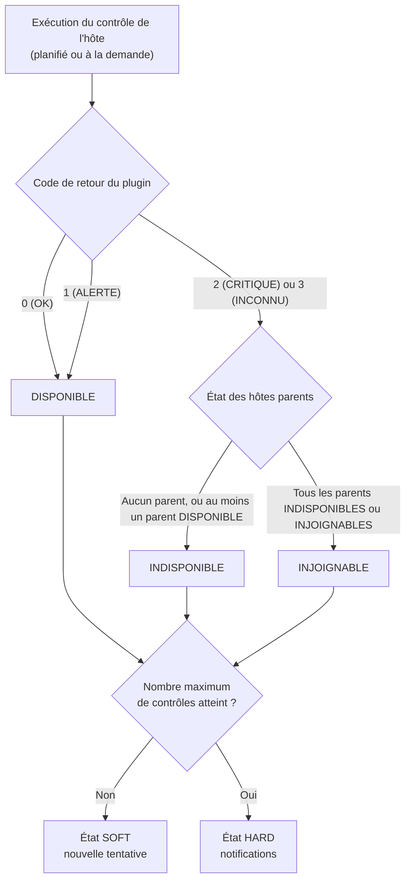

Cette page explique comment Centreon Engine détermine si un hôte est DISPONIBLE, INDISPONIBLE ou INJOIGNABLE, et à quel moment ce statut est confirmé.

À retenir : **le statut d'un hôte dépend de sa propre commande de contrôle, et non de ses services.** Un hôte peut être DISPONIBLE alors que tous ses services sont CRITIQUES.

## Exemple utilisé dans cette page

| Élément | Valeur |
|---------|--------|
| Hôte | `srv-linux-01` (`192.168.1.20`) |
| Modèle d'hôte | `OS-Linux-SNMP-custom` (fourni par le connecteur de supervision Linux SNMP) |
| Hôte parent | `rtr-site-a` (le routeur situé devant le serveur) |
| Commande de contrôle de l'hôte | `base_host_alive` (exécute `check_icmp`) |
| Intervalle de contrôle | 5 minutes |
| Intervalle de nouvelle tentative | 1 minute |
| Nombre maximum de contrôles | 3 |

## Vue d'ensemble



## Statuts possibles d'un hôte

| Statut | Signification |
|--------|---------------|
| EN ATTENTE | L'hôte n'a pas encore été contrôlé |
| DISPONIBLE | L'hôte répond à son contrôle |
| INDISPONIBLE | L'hôte ne répond pas, alors que le chemin réseau qui y mène fonctionne |
| INJOIGNABLE | L'hôte ne peut pas être contrôlé, car tous les chemins qui y mènent passent par un hôte parent en panne |

> **Remarque :** ne confondez pas les codes de retour des plugins avec les codes de statut des hôtes. Un plugin renvoie `0` (OK), `1` (ALERTE), `2` (CRITIQUE) ou `3` (INCONNU). Centreon enregistre ensuite les statuts des hôtes avec leurs propres codes : `0` (DISPONIBLE), `1` (INDISPONIBLE), `2` (INJOIGNABLE). Un statut d'hôte égal à `1` signifie donc INDISPONIBLE, et non ALERTE.

## Étape 1 : Centreon Engine exécute le contrôle de l'hôte

Centreon Engine exécute la commande de contrôle de l'hôte dans les cas suivants :

- **Contrôles planifiés** : à chaque intervalle de contrôle (ici, toutes les 5 minutes), ou à chaque intervalle de nouvelle tentative (1 minute) tant qu'un problème est en cours de confirmation. Si l'intervalle de contrôle vaut `0`, aucun contrôle régulier n'est planifié.
- **Contrôles à la demande** : lorsqu'un service de l'hôte change d'état. Par exemple, si un service de `srv-linux-01` passe en CRITIQUE, Centreon Engine contrôle l'hôte pour savoir si tout le serveur est en panne.
- **Contrôles d'accessibilité** : lorsqu'un hôte tombe, Centreon Engine peut contrôler ses hôtes parents pour localiser la panne (voir l'[étape 3](#étape-3--indisponible-ou-injoignable)).

Pour `srv-linux-01`, le contrôle exécute :

```text
/usr/lib/nagios/plugins/check_icmp -H 192.168.1.20 -w 3000.0,80% -c 5000.0,100% -p 1
```

Le parcours de cette commande, de sa planification à son exécution, est décrit dans [Parcours d'un contrôle de service](./workflow-service-check.md).

> **Fourni par le connecteur de supervision :** la commande de contrôle de l'hôte, ses seuils, les intervalles de contrôle et le nombre maximum de contrôles ne sont pas définis sur l'hôte lui-même. Ils sont hérités du modèle d'hôte appliqué à l'hôte, ici `OS-Linux-SNMP-custom`, fourni par le connecteur de supervision. Vous pouvez les surcharger sur l'hôte si besoin.
>
> Les étapes 2 à 5 sont prises en charge par Centreon Engine et ne dépendent pas du connecteur de supervision. Les hôtes parents utilisés à l'étape 3 sont définis dans la configuration de l'hôte.

## Étape 2 : le code de retour donne un état provisoire

Centreon Engine convertit le code de retour du plugin en état provisoire de l'hôte :

| Code de retour du plugin | État provisoire de l'hôte |
|--------------------------|---------------------------|
| `0` (OK) | DISPONIBLE |
| `1` (ALERTE) | DISPONIBLE |
| `2` (CRITIQUE) | INDISPONIBLE |
| `3` (INCONNU) | INDISPONIBLE |

Un hôte n'a pas de statut ALERTE : un résultat ALERTE signifie que l'hôte est DISPONIBLE. Si le contrôle agressif des hôtes (`use_aggressive_host_checking`) est activé sur le collecteur, un résultat ALERTE signifie au contraire INDISPONIBLE.

Si l'état provisoire est DISPONIBLE, il est définitif. S'il est INDISPONIBLE, Centreon Engine passe à l'étape 3.

## Étape 3 : INDISPONIBLE ou INJOIGNABLE

Un serveur qui ne répond pas peut être en panne, mais le routeur situé devant lui peut aussi être défaillant. Pour faire la différence, Centreon Engine examine les **hôtes parents** de l'hôte (le champ **Hôtes parents** de la configuration de l'hôte) :

| État provisoire | Hôtes parents | État final |
|-----------------|---------------|------------|
| INDISPONIBLE | Aucun parent | INDISPONIBLE |
| INDISPONIBLE | Au moins un parent est DISPONIBLE | INDISPONIBLE |
| INDISPONIBLE | Tous les parents sont INDISPONIBLES ou INJOIGNABLES | INJOIGNABLE |

Dans cet exemple :

- `srv-linux-01` ne répond plus et `rtr-site-a` est DISPONIBLE : le problème vient du serveur lui-même. `srv-linux-01` est **INDISPONIBLE**.
- `srv-linux-01` ne répond plus et `rtr-site-a` est INDISPONIBLE : le serveur fonctionne peut-être, mais il est impossible de l'atteindre. `srv-linux-01` est **INJOIGNABLE**.

Lors d'une panne, vous allez ainsi directement à la cause : le routeur, et non les dizaines d'hôtes situés derrière lui. Si aucun hôte parent n'est défini, un hôte n'est jamais INJOIGNABLE, et une panne réseau apparaît sous la forme de nombreux hôtes INDISPONIBLES.

## Étape 4 : SOFT ou HARD

Un nouvel état n'est pas validé immédiatement. Centreon Engine le confirme en contrôlant l'hôte à nouveau, jusqu'à atteindre le **nombre maximum de contrôles** :

- **SOFT** : un changement a été détecté, mais il n'est pas encore confirmé. Les contrôles ont lieu à l'intervalle de nouvelle tentative.
- **HARD** : l'état est confirmé. Les contrôles reprennent à l'intervalle de contrôle normal.

Exemple avec un intervalle de contrôle de 5 minutes, un intervalle de nouvelle tentative de 1 minute et un nombre maximum de contrôles de 3 :

| Temps | Tentative | Statut | Type d'état | Ce qui se passe |
|-------|-----------|--------|-------------|-----------------|
| t+0 | 1/3 | DISPONIBLE | HARD | Situation normale |
| t+5 | 1/3 | INDISPONIBLE | SOFT | Premier contrôle en échec. Les gestionnaires d'évènements s'exécutent. Prochain contrôle dans 1 minute. |
| t+6 | 2/3 | INDISPONIBLE | SOFT | Toujours en échec. Les gestionnaires d'évènements s'exécutent. |
| t+7 | 3/3 | INDISPONIBLE | HARD | Nombre maximum de contrôles atteint. L'état INDISPONIBLE est confirmé et une notification de problème est envoyée. |
| t+12 | 3/3 | INDISPONIBLE | HARD | Toujours en panne. Les notifications suivantes dépendent de l'intervalle de notification. |
| t+17 | 1/3 | DISPONIBLE | HARD | L'hôte répond de nouveau : notification de rétablissement. |

Si l'hôte répond de nouveau alors que l'état est encore SOFT (par exemple, à t+6), il redevient DISPONIBLE sans qu'aucune notification ne soit envoyée : il s'agissait d'une brève perturbation, et non d'une véritable panne.

Dans **Supervision > Statut des ressources**, la colonne **Essais** indique la tentative en cours (par exemple, `2/3`) et si l'état est SOFT ou HARD.

## Étape 5 : ce que déclenche un état HARD

Lorsqu'un hôte passe dans un état de problème HARD ou en sort :

- **Des notifications** sont envoyées aux contacts de l'hôte, selon ses options de notification. Les notifications INDISPONIBLE, INJOIGNABLE et de rétablissement peuvent être activées séparément : vous pouvez par exemple ne pas notifier les hôtes INJOIGNABLES et ne notifier que le parent en panne.
- **Les gestionnaires d'évènements** s'exécutent. Ils s'exécutent également lors des changements d'état SOFT.
- Centreon Broker envoie le statut au serveur central, et celui-ci s'affiche dans Centreon Web, comme décrit dans [Parcours d'un contrôle de service](./workflow-service-check.md).

## Ce qui ne modifie pas le statut de l'hôte

| Élément | Effet sur le statut de l'hôte |
|---------|-------------------------------|
| Les services de l'hôte | Aucun. Les services peuvent seulement déclencher un contrôle de l'hôte à la demande. Leurs propres statuts ne sont pas pris en compte. |
| Acquittement | Aucun. Le statut reste INDISPONIBLE ; seules les notifications s'arrêtent, et le problème est marqué comme pris en charge. |
| Plage de maintenance | Aucun. Le statut est toujours calculé ; les notifications sont suspendues pendant la plage de maintenance. |
| Bagotage | Aucun. Le statut continue de changer, mais l'hôte est signalé comme étant en bagotage et les notifications sont suspendues. |

## Questions fréquentes

**Tous les services de mon hôte sont CRITIQUES, mais l'hôte est DISPONIBLE. Est-ce un bug ?**
Non. Le statut de l'hôte ne reflète que sa propre commande de contrôle, généralement un ping. Le serveur répond aux pings : il est donc DISPONIBLE, même si les applications qu'il héberge sont en échec.

**Mon hôte est INJOIGNABLE, mais le serveur fonctionne.**
Au moins un de ses hôtes parents est INDISPONIBLE ou INJOIGNABLE. Vérifiez d'abord les parents, puis vérifiez que les relations de parenté définies dans la configuration correspondent à votre réseau réel.

**Le plugin qui contrôle mon hôte renvoie ALERTE, mais l'hôte est DISPONIBLE.**
C'est normal : les contrôles d'hôtes n'ont pas d'état ALERTE, et ALERTE signifie DISPONIBLE, sauf si le contrôle agressif des hôtes est activé.

**Pourquoi mon hôte est-il passé INDISPONIBLE sans aucune notification ?**
L'état était probablement encore SOFT. Les notifications ne sont envoyées qu'une fois l'état passé en HARD, après le nombre maximum de contrôles.
