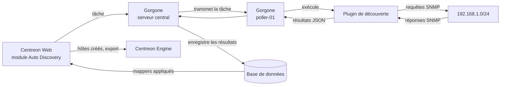

## Parcours d'une tâche de découverte d'hôtes : trouver des serveurs Linux avec SNMP

Cette page suit une tâche de découverte d'hôtes depuis sa création dans Centreon Web jusqu'à la supervision des hôtes découverts. Elle prend comme exemple une découverte SNMP de serveurs Linux sur un sous-réseau.

Les étapes dans lesquelles le connecteur de supervision intervient sont signalées par **Fourni par le connecteur de supervision**. Les autres étapes sont prises en charge par les composants de Centreon.

## Exemple utilisé dans cette page

| Élément | Valeur |
|------|-------|
| Fournisseur de découverte | Generic SNMP agents |
| Sous-réseau analysé | `192.168.1.0/24` |
| Version et communauté SNMP | `2c` / `public` |
| Collecteur qui exécute la découverte | `poller-01` |
| Hôte trouvé | `srv-linux-01` (`192.168.1.20`) |
| Modèle d'hôte appliqué | `OS-Linux-SNMP-custom` |

> **Remarque :** les noms des fournisseurs, les options des plugins et les noms des attributs dépendent de la version de votre connecteur de supervision. Les commandes et les sorties ci-dessous sont des exemples simplifiés.

## Vue d'ensemble



## Étape 1 : créer la tâche de découverte

Allez à la page **Configuration > Hôtes > Découverte** et cliquez sur **+AJOUTER**. Un assistant s'ouvre :

1. **Choix du fournisseur** : sélectionnez **Generic SNMP agents**. Les fournisseurs sont fournis avec les connecteurs de supervision : le connecteur correspondant doit donc être installé.
2. **Paramètres d'accès** : saisissez la version SNMP (`2c`) et la communauté SNMP (`public`).
3. **Paramètres supplémentaires** : saisissez le sous-réseau à analyser (`192.168.1.0/24`) et sélectionnez le collecteur qui exécutera la découverte (`poller-01`). Le collecteur doit pouvoir joindre le sous-réseau.
4. **Mappers** : définissez comment les éléments découverts deviennent des hôtes (voir l'[étape 7](#étape-7--les-mappers-transforment-les-résultats-en-hôtes)).
5. **Analyse** : choisissez **Analyse manuelle** (vous sélectionnez les hôtes à créer) ou **Analyse automatique** (les hôtes sont créés automatiquement).
6. **Exécution** : exécutez la tâche immédiatement ou planifiez-la.

Cliquez sur **TERMINER**. La tâche apparaît dans la liste avec le statut **Programmé** ou **En cours**.

> **Fourni par le connecteur de supervision :** le fournisseur de découverte. Il définit la commande de découverte, les paramètres demandés par l'assistant et les attributs renvoyés par la découverte. L'assistant ne propose que les fournisseurs des connecteurs de supervision installés sur votre plateforme.

## Étape 2 : Centreon Web confie la tâche à Gorgone

Le module Auto Discovery envoie la tâche au démon Gorgone du serveur central. Gorgone construit la commande de découverte à partir de la définition du fournisseur et des paramètres que vous avez saisis.

## Étape 3 : Gorgone transmet la tâche au collecteur

La tâche est affectée à `poller-01` : Gorgone, sur le serveur central, la transmet donc à Gorgone sur `poller-01`. La découverte s'exécute sur le collecteur, au plus près du réseau analysé. Le serveur central n'a pas besoin de joindre lui-même le sous-réseau.

## Étape 4 : le collecteur exécute le plugin de découverte

Gorgone, sur `poller-01`, exécute le plugin de découverte. La commande ressemble à ceci (version simplifiée) :

```text
/usr/lib/centreon/plugins/centreon_generic_snmp.pl --plugin=os::linux::snmp::plugin \
  --mode=discovery --subnet='192.168.1.0/24' \
  --snmp-community='public' --snmp-version='2c' --snmp-port='161'
```

> **Fourni par le connecteur de supervision :** le plugin de découverte. Il doit être installé sur le collecteur qui exécute la découverte. Si l'option **Installation automatique des plugins** est réglée sur **ON** à la page **Configuration > Connecteurs > Connecteurs de supervision**, il est installé automatiquement lors de l'exécution de la tâche.

## Étape 5 : le plugin analyse le sous-réseau

Le plugin envoie une requête SNMP à chaque adresse du sous-réseau. Il conserve les adresses où un agent SNMP répond. Pour chacune d'elles, il lit des informations système de base, comme le nom et la description du système, et en déduit le type d'équipement.

```text
poller-01 → SNMP get sysDescr, sysName → 192.168.1.1 … 192.168.1.254
poller-01 ← reply from 192.168.1.20: "Linux srv-linux-01 5.14.0 x86_64"
poller-01 ← reply from 192.168.1.21: "Cisco IOS Software …"
(no reply from the other addresses)
```

## Étape 6 : les résultats reviennent au serveur central

Le plugin renvoie ses résultats au format JSON. Gorgone, sur le collecteur, les renvoie à Gorgone sur le serveur central, qui les enregistre dans la base de données. Le statut de la tâche passe à **Terminé**.

```json
{
  "discovered_items": 2,
  "results": [
    {
      "ip": "192.168.1.20",
      "hostname": "srv-linux-01",
      "type": "linux",
      "description": "Linux srv-linux-01 5.14.0 x86_64",
      "snmp_community": "public",
      "snmp_version": "2c",
      "snmp_port": 161
    },
    {
      "ip": "192.168.1.21",
      "hostname": "sw-core-01",
      "type": "cisco",
      "description": "Cisco IOS Software …",
      "snmp_community": "public",
      "snmp_version": "2c",
      "snmp_port": 161
    }
  ]
}
```

## Étape 7 : les mappers transforment les résultats en hôtes

Le module Auto Discovery applique les mappers de la tâche à chaque résultat. Les mappers traduisent les attributs découverts en paramètres d'hôte Centreon :

| Mapper | Règle dans cet exemple | Résultat pour `srv-linux-01` |
|--------|---------------------|---------------------------|
| Propriété | Nom ← `hostname`, adresse ← `ip` | Nom `srv-linux-01`, adresse `192.168.1.20` |
| Exclusion | Exclure si `type` n'est pas `linux` | `sw-core-01` est exclu |
| Modèle | Ajouter `OS-Linux-SNMP-custom` | Modèle appliqué |
| Groupe d'hôtes | `os-` + `type` | Rattaché au groupe d'hôtes `os-linux` (créé s'il n'existe pas) |
| Supervision | Supervisé depuis `poller-01` | Affecté à `poller-01` |

Si vous modifiez les mappers avant la création des hôtes, les résultats sont mis à jour immédiatement.

> **Fourni par le connecteur de supervision :** le modèle d'hôte appliqué par le mapper Modèle. Dans cet exemple, `OS-Linux-SNMP-custom` est fourni par le connecteur de supervision Linux SNMP. Les attributs utilisables dans les mappers (`hostname`, `ip`, `type`, etc.) sont définis par le fournisseur de découverte.

## Étape 8 : vous vérifiez les résultats

À la page **Configuration > Hôtes > Découverte**, cliquez sur la flèche à côté du statut de la tâche pour afficher les résultats. Une icône indique ce qui va se passer pour chaque hôte :

- **Icône plus** : l'hôte n'existe pas encore et sera créé.
- **Icône flèche** : l'hôte existe déjà et sera mis à jour (uniquement si l'option **Modifier les hôtes existants** a été sélectionnée).

Avec l'**Analyse manuelle**, sélectionnez `srv-linux-01` et cliquez sur **Sauvegarder**. Avec l'**Analyse automatique**, cette étape se fait toute seule. La tâche passe par le statut **En cours d'enregistrement**.

## Étape 9 : les hôtes sont créés

`srv-linux-01` est créé dans **Configuration > Hôtes > Hôtes**. Les services liés à son modèle d'hôte (CPU, mémoire, disques, trafic, etc.) sont créés en même temps.

> **Fourni par le connecteur de supervision :** les modèles de service liés au modèle d'hôte. Ils déterminent quels services sont créés et avec quels seuils par défaut. Le modèle d'hôte est aussi lié aux règles de découverte de services du connecteur : vous pouvez ensuite découvrir les interfaces, les disques et les autres éléments de l'hôte (voir [Parcours d'une règle de découverte de services](./workflow-service-discovery.md)).

## Étape 10 : la configuration est exportée

Exportez la configuration de `poller-01` et rechargez-la. Si l'option **Exporter et recharger la configuration des collecteurs** a été sélectionnée dans l'assistant de la tâche, cette étape est automatique. Centreon Engine sur `poller-01` connaît désormais `srv-linux-01` et commence à planifier ses contrôles.

À partir de là, chaque contrôle suit le parcours décrit dans [Parcours d'un contrôle de service](./workflow-service-check.md).

## Découverte et contrôles : les différences

Une tâche de découverte et un contrôle de supervision exécutent tous deux des plugins sur un collecteur, mais ils suivent des chemins différents :

| | Tâche de découverte | Contrôle de supervision |
|---|---|---|
| Déclenché par | Vous, ou la planification de la tâche | Centreon Engine, à chaque intervalle de contrôle |
| Exécuté par | Gorgone | Centreon Engine |
| Sortie du plugin | Liste JSON des éléments découverts | Code de retour, sortie et données de performance |
| Destination des résultats | Module Auto Discovery, puis configuration des hôtes | Centreon Broker, puis statut en temps réel et graphiques |
| Fourni par le connecteur de supervision | Le fournisseur de découverte | La commande et les modèles d'hôte et de service |

Dans les deux cas, le connecteur de supervision fournit ce qui est nécessaire : le fournisseur de découverte, qui définit la commande de découverte, ainsi que les modèles et les commandes utilisés par les contrôles des hôtes qu'il crée.

## Comportements à connaître

- Les hôtes qui ne sont plus découverts ne sont **pas** désactivés automatiquement. Seuls les hôtes découverts et exclus par un mapper d'exclusion peuvent être désactivés.
- Lorsque des hôtes existants sont mis à jour, leur nom, leur alias et leur adresse IP (définis par les mappers Propriété) ne sont pas modifiés.
- Modifier les mappers après la création des hôtes n'a aucun effet sur ces hôtes, sauf si l'option **Modifier les hôtes existants** est sélectionnée.
