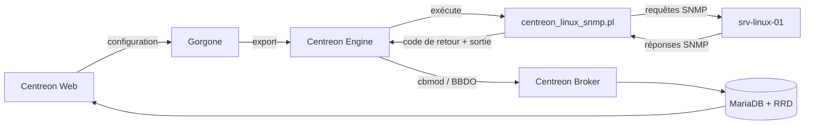

## Parcours d'un contrôle de service : l'utilisation CPU d'un serveur Linux

Cette page suit un contrôle de service unique, depuis sa configuration dans Centreon Web jusqu'à l'affichage de son résultat. Elle prend pour exemple le contrôle CPU du connecteur de supervision Linux SNMP.
<!-- , and explains where Centreon connectors come into play. -->

Les étapes dans lesquelles le connecteur de supervision intervient sont signalées par **Fourni par le connecteur de supervision**. Les autres étapes sont prises en charge par les composants de Centreon.


## Exemple utilisé dans cette page

| Élément | Valeur |
|---------|--------|
| Connecteur de supervision | Linux SNMP |
| Hôte | `srv-linux-01` (`192.168.1.20`) |
| Modèle d'hôte | `OS-Linux-SNMP-custom` |
| Version SNMP et communauté SNMP | `2c` / `public` |
| Service | `Cpu` |
| Modèle de service | `OS-Linux-Cpu-SNMP-custom` |
| Commande | `OS-Linux-SNMP-Cpu` |
| Plugin | `centreon_linux_snmp.pl`, mode `cpu` |
| Intervalle de contrôle | 5 minutes |

> **Remarque :** les noms des commandes, les macros et les seuils dépendent de la version de votre connecteur de supervision. Les valeurs ci-dessous sont des exemples types.

## Vue d'ensemble



## Étape 1 : déclarer le contrôle

Dans Centreon Web, créez l'hôte `srv-linux-01` (`192.168.1.20`) avec le modèle d'hôte `OS-Linux-SNMP-custom`, puis renseignez sa version SNMP (`2c`) et sa communauté SNMP (`public`). Si vous cochez **Créer aussi les services liés aux modèles**, le service `Cpu` est créé automatiquement avec le modèle de service `OS-Linux-Cpu-SNMP-custom`.

Le modèle de service utilise la commande `OS-Linux-SNMP-Cpu` (version simplifiée) :

```text
$CENTREONPLUGINS$/centreon_linux_snmp.pl --plugin=os::linux::snmp::plugin --mode=cpu \
  --hostname=$HOSTADDRESS$ --snmp-version='$_HOSTSNMPVERSION$' \
  --snmp-community='$_HOSTSNMPCOMMUNITY$' $_HOSTSNMPEXTRAOPTIONS$ \
  --warning-average='$_SERVICEWARNING$' --critical-average='$_SERVICECRITICAL$' \
  $_SERVICEEXTRAOPTIONS$
```

Macros du service, avec leurs valeurs par défaut :

```text
WARNING=80
CRITICAL=90
```

> **Fourni par le connecteur de supervision :** vous n'écrivez pas cette commande vous-même. Le modèle d'hôte, le modèle de service, la commande et les seuils par défaut sont tous fournis avec le connecteur de supervision. Vous ajustez seulement les valeurs nécessaires, comme la communauté SNMP ou les seuils.

<!-- The command's **Connector** field is empty. See [Step 4](#step-4-engine-chooses-how-to-run-the-command) for why this matters. -->

## Étape 2 : exporter la configuration

Lorsque vous exportez la configuration, Gorgone génère les fichiers de configuration de Centreon Engine, les copie sur le collecteur qui supervise `srv-linux-01`, puis recharge Centreon Engine sur ce collecteur.

```text
define service {
  host_name            srv-linux-01
  service_description  Cpu
  check_command        OS-Linux-SNMP-Cpu
  check_interval       5
  max_check_attempts   3
}
```

## Étape 3 : Engine planifie le contrôle et construit la commande

Toutes les 5 minutes, Centreon Engine exécute le service **Cpu**. Il remplace chaque macro par sa valeur réelle pour obtenir une ligne de commande prête à être exécutée :

```text
/usr/lib/centreon/plugins/centreon_linux_snmp.pl --plugin=os::linux::snmp::plugin --mode=cpu \
  --hostname=192.168.1.20 --snmp-version='2c' --snmp-community='public' \
  --warning-average='80' --critical-average='90'
```

## Étape 4 : Engine exécute le plugin

Centreon Engine lance un nouveau processus sur le collecteur et exécute `centreon_linux_snmp.pl` avec cette ligne de commande.

> **Fourni par le connecteur de supervision :** le plugin. Il doit être installé sur le collecteur qui exécute le contrôle. Vous pouvez l'installer manuellement, ou laisser Centreon l'installer automatiquement lors du déploiement de la configuration, si l'option **Installation automatique des plugins** est réglée sur **ON** à la page **Configuration > Connecteurs > Connecteurs de supervision**.

<!--
## Step 4: Engine chooses how to run the command

This is where a connector would come into play.

Centreon Engine checks whether a connector is defined for the command. Here, none is defined, so Engine forks a new process and runs `check_icmp` directly.

This is the right choice for a ping: `check_icmp` is a small compiled C program that starts in a few milliseconds, so a connector would bring no benefit.

Connectors matter for Perl plugins and SSH checks, where starting from scratch on every check is expensive. See [The role of the connector](#the-role-of-the-connector).
-->

## Étape 5 : le plugin interroge le serveur

Le plugin envoie des requêtes SNMP à `192.168.1.20` sur le port UDP 161 et lit l'utilisation CPU de chaque cœur. L'agent SNMP de `srv-linux-01` répond : il doit être configuré pour accepter les requêtes du collecteur avec la communauté `public`.

```text
poller → SNMP get CPU usage per core → 192.168.1.20:161
poller ← core 0: 10 %, core 1: 15 %
computed: average 12.50 %
```

## Étape 6 : le plugin renvoie son résultat

Le plugin compare l'utilisation CPU moyenne aux seuils (alerte à 80 %, critique à 90 %), puis se termine. Centreon Engine lit :

- le **code de retour** : `0` (OK), `1` (ALERTE), `2` (CRITIQUE) ou `3` (INCONNU) ;
- la **sortie** : le texte situé avant le caractère `|` ;
- les **données de performance** : le texte situé après le caractère `|`.

```text
exit code: 0

OK: 2 CPU(s) average usage is 12.50 % | 'cpu.utilization.percentage'=12.50%;0:80;0:90;0;100 '0#core.cpu.utilization.percentage'=10.00%;;;0;100 '1#core.cpu.utilization.percentage'=15.00%;;;0;100
```

> **Fourni par le connecteur de supervision :** le plugin définit ce qui est mesuré, le libellé de la sortie et le nom des métriques (ici, `cpu.utilization.percentage` et `core.cpu.utilization.percentage`). Les modèles du connecteur sont construits autour de ces métriques : leurs macros définissent les seuils auxquels le plugin compare les mesures. Les métriques de chaque service sont listées dans la procédure de supervision du connecteur.

## Étape 7 : Engine détermine l'état

Le code de retour `0` signifie OK : aucune autre action n'est donc entreprise.

Si l'utilisation CPU moyenne dépassait 90 %, le plugin renverrait `2` (CRITIQUE). Centreon Engine passerait alors le service dans un état CRITIQUE **SOFT** et relancerait le contrôle, jusqu'à atteindre `max_check_attempts` (3 dans cet exemple). L'état ne devient CRITIQUE **HARD**, et ne déclenche de notifications, que si toutes les tentatives échouent.

## Étape 8 : le résultat est envoyé au serveur central

Le module broker chargé dans Centreon Engine (cbmod) convertit le résultat en évènement et le transmet via le protocole BBDO (port TCP 5669) à Centreon Broker, sur le serveur central.

```text
service_status  host=srv-linux-01  service=Cpu
state=OK
output="OK: 2 CPU(s) average usage is 12.50 %"
perfdata="'cpu.utilization.percentage'=12.50%;0:80;0:90;0;100 ..."
```

## Étape 9 : Centreon Broker enregistre le résultat

Centreon Broker :

- écrit le statut en temps réel dans la base de données MariaDB (`centreon_storage`) ;
- envoie les métriques (`cpu.utilization.percentage` et une métrique `core.cpu.utilization.percentage` par cœur) dans des fichiers RRD, qui servent à tracer les graphiques.

## Étape 10 : le résultat s'affiche

Dans **Supervision > Statut des ressources**, le service **Cpu** de `srv-linux-01` s'affiche à l'état **OK** avec sa sortie, et de nouveaux points s'ajoutent au graphique de performance.

Cinq minutes plus tard, Centreon Engine recommence à l'[étape 3](#étape-3--engine-planifie-le-contrôle-et-construit-la-commande).

<!--
## The role of the connector

A connector is a long-lived process running on the poller. When a command is linked to a connector, Centreon Engine doesn't start a new process for each check: it sends the command line to the connector, which runs it and returns the result.

Centreon provides two connectors:

| Connector | What it keeps in memory | Benefit |
|-----------|-------------------------|---------|
| Centreon Connector Perl | A running Perl interpreter and compiled plugin code | No interpreter startup or code compilation on each check |
| Centreon Connector SSH | Open SSH sessions to monitored hosts | No new SSH connection and handshake on each check |

Comparison for a single check:

| Type of check | Without connector | With connector |
|---------------|-------------------|----------------|
| Ping (`check_icmp`, compiled C) | Fork, run binary | Not applicable |
| Perl plugin (`centreon_plugins.pl`) | Fork, start Perl, compile plugin, run | Run cached code |
| SSH check | Fork, open SSH session, authenticate, run | Run in existing session |

On pollers that run thousands of Perl or SSH checks, connectors significantly reduce CPU load and check latency. To use one, select it in the **Connector** field of the command definition.
-->
