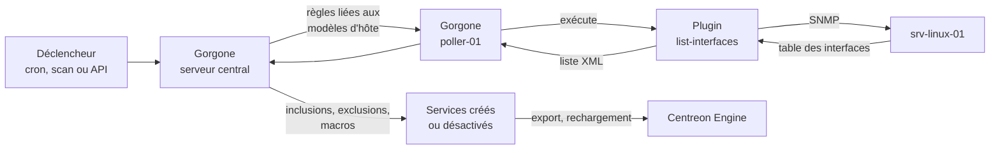

## Parcours d'une règle de découverte de services : trouver les interfaces réseau d'un serveur Linux

Cette page suit une découverte de services depuis son déclenchement jusqu'à la supervision des services découverts. Elle prend comme exemple la découverte des interfaces réseau d'un serveur Linux.

Les étapes dans lesquelles le connecteur de supervision intervient sont signalées par **Fourni par le connecteur de supervision**. Les autres étapes sont prises en charge par les composants de Centreon.

Elle fait suite à [Parcours d'une tâche de découverte d'hôtes](./workflow-host-discovery.md) : l'hôte `srv-linux-01` a été créé avec le modèle d'hôte `OS-Linux-SNMP-custom`.

## Exemple utilisé dans cette page

| Élément | Valeur |
|------|-------|
| Hôte | `srv-linux-01` (`192.168.1.20`) |
| Modèle d'hôte | `OS-Linux-SNMP-custom` |
| Règle de découverte | `OS-Linux-SNMP-Traffic-Name` |
| Mode de découverte | `list-interfaces` |
| Modèle de service appliqué | `OS-Linux-Traffic-Generic-Name-SNMP-custom` |
| Services créés | `Traffic-eth0`, `Traffic-eth1` |

> **Remarque :** les noms des règles, les modèles de service, les macros et les attributs XML dépendent de la version de votre connecteur de supervision. Les commandes et les sorties ci-dessous sont des exemples simplifiés.

## Découverte d'hôtes et découverte de services

La découverte d'hôtes et la découverte de services sont deux mécanismes distincts du module Auto Discovery :

- La **découverte d'hôtes** utilise des **tâches** : elle analyse un réseau, un compte cloud ou un hyperviseur pour trouver des hôtes.
- La **découverte de services** utilise des **règles** : elle examine l'*intérieur* d'hôtes qui existent déjà pour trouver des éléments à superviser, comme des interfaces réseau, des disques ou des systèmes de fichiers, et crée un service par élément.

## Vue d'ensemble



## Étape 1 : la règle est définie

Les règles de découverte sont listées à la page **Configuration > Services > Règles**. La plupart des connecteurs de supervision fournissent des règles prêtes à l'emploi. La règle utilisée ici contient :

| Paramètre | Valeur dans cet exemple | Rôle |
|---------|----------------------|---------|
| **Command Macro** | `OS-Linux-SNMP-Traffic-Name` | Commande utilisée pour énumérer les éléments |
| **Command Discover** | `os-linux-snmp-list-interfaces` | Commande qui liste les éléments de l'hôte |
| **Service template** | `OS-Linux-Traffic-Generic-Name-SNMP-custom` | Modèle utilisé pour chaque nouveau service |
| **Service display name** | `Traffic-$name$` | Nom de chaque nouveau service, construit à partir d'un attribut XML |
| **Host templates** | `OS-Linux-SNMP-custom` | La règle s'applique à tous les hôtes qui utilisent ce modèle |
| **Disable elements not found** | Activé | Désactive les services dont l'élément a disparu |
| **Update existing services** | Activé | Met à jour les macros des services déjà créés |
| **Contact groups** | `Supervisors` | Groupe notifié lors de la création ou de la désactivation de services |
| **Activate** | Activé | Les règles inactives sont ignorées |

Comme `srv-linux-01` utilise `OS-Linux-SNMP-custom`, cette règle s'y applique sans configuration supplémentaire.

> **Fourni par le connecteur de supervision :** la règle elle-même, installée avec le connecteur de supervision Linux SNMP, avec ses commandes de découverte, son modèle de service, son lien vers le modèle d'hôte et ses inclusions et exclusions par défaut. Vous pouvez l'adapter, par exemple pour modifier les inclusions ou pour l'activer.

## Étape 2 : la découverte est déclenchée

Une découverte de services peut démarrer de trois façons :

- **Planifiée** : le module cron de Gorgone exécute régulièrement toutes les règles actives. Par défaut, tous les jours à 22 h 30, comme défini dans `/etc/centreon-gorgone/config.d/cron.d/41-service-discovery.yaml` :

  ```yaml
  - id: service_discovery
    timespec: "30 22 * * *"
    action: LAUNCHSERVICEDISCOVERY
  ```

- **Scan manuel** : à la page **Configuration > Services > Scan**, sélectionnez un hôte et lancez la découverte pour afficher les résultats et choisir ceux à conserver.
- **API** : envoyez une requête à l'API Gorgone, éventuellement filtrée par règle, par hôte ou par collecteur. Utilisez `dry_run` pour tester sans modifier la configuration :

  ```bash
  curl --request POST "http://localhost:8085/api/centreon/autodiscovery/services" \
    --header "Content-Type: application/json" \
    --data '{"filter_rules": ["OS-Linux-SNMP-Traffic-Name"], "filter_hosts": ["srv-linux-01"], "dry_run": 1}'
  ```

## Étape 3 : Gorgone détermine les hôtes et les règles à exécuter

Gorgone, sur le serveur central, liste les règles actives, puis les hôtes qui utilisent les modèles d'hôte liés à chaque règle. Ici, il détermine que `OS-Linux-SNMP-Traffic-Name` doit s'exécuter sur `srv-linux-01`.

Gorgone complète la commande de la règle avec les valeurs de l'hôte (adresse, communauté SNMP, macros) et l'envoie à Gorgone sur le collecteur qui supervise l'hôte, `poller-01`.

## Étape 4 : le collecteur exécute le plugin de découverte

Gorgone, sur `poller-01`, exécute le plugin dans un mode `list-` avec l'option `--disco-show` :

```text
/usr/lib/centreon/plugins/centreon_linux_snmp.pl --mode=list-interfaces \
  --hostname=192.168.1.20 --snmp-version=2c --snmp-community=public --disco-show
```

> **Fourni par le connecteur de supervision :** le plugin et son mode `list-interfaces`. C'est le même plugin que celui utilisé pour les contrôles de l'hôte : il est donc déjà installé sur le collecteur qui supervise l'hôte.

## Étape 5 : le plugin lit les interfaces du serveur

Le plugin interroge en SNMP la table des interfaces de `srv-linux-01` et récupère chaque interface avec son nom, son statut et son débit.

```text
poller-01 → SNMP walk interface table → 192.168.1.20
poller-01 ← lo   (up)
poller-01 ← eth0 (up, 1000 Mb/s)
poller-01 ← eth1 (up, 1000 Mb/s)
poller-01 ← eth2 (down)
```

## Étape 6 : le plugin renvoie une liste XML

Avec `--disco-show`, le plugin renvoie un élément XML par élément découvert. Chaque information est un attribut XML :

```xml
<?xml version="1.0" encoding="utf-8"?>
<data>
  <label name="lo" status="up" total="10" interfaceid="1"/>
  <label name="eth0" status="up" total="1000" interfaceid="2"/>
  <label name="eth1" status="up" total="1000" interfaceid="3"/>
  <label name="eth2" status="down" total="1000" interfaceid="4"/>
</data>
```

Pour savoir quels attributs un mode renvoie, exécutez-le avec `--disco-format` au lieu de `--disco-show`. Les mêmes attributs sont affichés dans l'onglet **Inclusions/Exclusions & Macros** de la règle.

> **Fourni par le connecteur de supervision :** la liste des attributs XML, définie par le mode du plugin. Ce sont ces attributs que vous pouvez filtrer et associer à des macros dans la règle.

Gorgone, sur le collecteur, renvoie la liste à Gorgone sur le serveur central.

## Étape 7 : les inclusions et les exclusions filtrent la liste

Les inclusions et les exclusions de la règle sont appliquées aux attributs XML :

| Règle | Attribut | Valeur | Effet |
|------|-----------|-------|--------|
| Exclusion | `name` | `^lo$` | `lo` est retiré |
| Inclusion | `status` | `up` | `eth2` est retiré |

Il reste deux éléments : `eth0` et `eth1`.

## Étape 8 : chaque élément devient un service

Pour chaque élément restant, la règle construit un service :

- **Nom** : `Traffic-$name$` donne `Traffic-eth0` et `Traffic-eth1`.
- **Modèle** : `OS-Linux-Traffic-Generic-Name-SNMP-custom`.
- **Macros** : les attributs XML sont associés à des macros de service. Par exemple, `name` alimente la macro `INTERFACENAME` : `Traffic-eth0` supervise donc `eth0`.

Les services sont créés sur `srv-linux-01`. Les éléments déjà présents dans la configuration sont ignorés, ou mis à jour si l'option **Update existing services** est activée.

Avec un scan manuel, rien n'est créé tant que vous n'avez pas sélectionné les éléments et enregistré.

> **Fourni par le connecteur de supervision :** le modèle de service `OS-Linux-Traffic-Generic-Name-SNMP-custom`, qui apporte la commande de contrôle, les macros et les seuils par défaut de chaque nouveau service.

## Étape 9 : les éléments disparus sont désactivés

L'option **Disable elements not found** est activée : Gorgone compare donc les éléments découverts avec les services créés par cette règle lors des exécutions précédentes. Si une interface a disparu, son service est désactivé.

Le groupe de contacts **Supervisors** reçoit un e-mail qui liste les services créés et désactivés.

## Étape 10 : la configuration est déployée

La configuration du collecteur est exportée et Centreon Engine est rechargé sur `poller-01`. `Traffic-eth0` et `Traffic-eth1` sont désormais planifiés comme n'importe quel autre service.

À partir de là, chaque contrôle suit le parcours décrit dans [Parcours d'un contrôle de service](./workflow-service-check.md).

<!-- These traffic checks use a Perl plugin, so they benefit from Centreon Connector Perl if the command is linked to it. -->


## Découverte d'hôtes et découverte de services : les différences

| | Découverte d'hôtes | Découverte de services |
|---|---|---|
| Configurée sous forme de | Tâches (**Configuration > Hôtes > Découverte**) | Règles (**Configuration > Services > Règles**) |
| Périmètre | Un réseau, un compte ou une plateforme | Les hôtes qui utilisent les modèles d'hôte de la règle |
| Déclenchée par | La planification de la tâche ou **Forcer l'exécution** | Le cron de Gorgone (quotidien par défaut), un scan manuel ou l'API |
| Exécutée par | Gorgone | Gorgone |
| Fourni par le connecteur de supervision | Le fournisseur de découverte | Les règles de découverte |
| Sortie du plugin | JSON | XML (`--disco-show`) |
| Transformation des résultats en objets | Mappers | Inclusions, exclusions et macros |
| Crée | Des hôtes (et les services de leurs modèles) | Des services sur des hôtes existants |
| Supprime ce qui a disparu | Non (seuls les hôtes exclus peuvent être désactivés) | Oui, avec **Disable elements not found** |

## Comportements à connaître

- Une règle ne s'exécute que sur les hôtes dont les modèles d'hôte lui sont liés. Si un hôte manque dans les résultats, vérifiez d'abord ses modèles.
- Une règle doit être activée pour s'exécuter depuis le cron ou l'API.
- Si vous renommez les services créés par une règle (en modifiant **Service display name**), la prochaine exécution crée de nouveaux services au lieu de reconnaître les anciens, ce qui produit des doublons.
- Testez vos modifications avec un scan manuel ou l'option `dry_run` de l'API avant de laisser l'exécution planifiée les appliquer.
