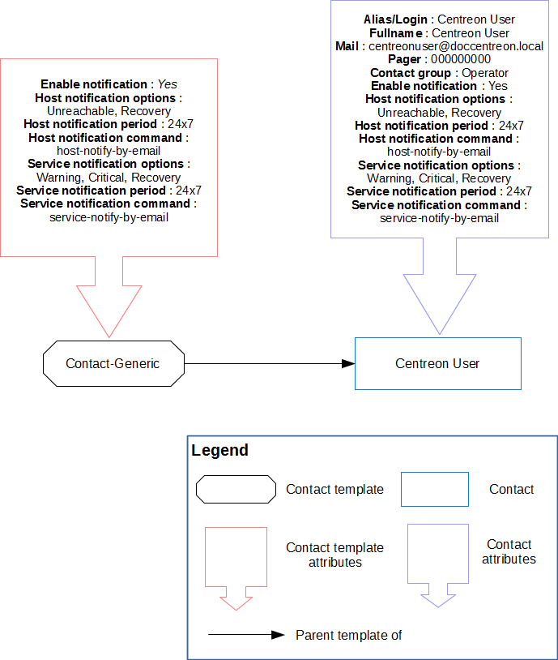

## Les modèles de contacts

Un contact ou un modèle de contact peut hériter d’un seul modèle de contact.

### Configuration

Pour ajouter un modèle de contacts :

Rendez-vous dans le menu **Configuration > Utilisateurs > Modèles de contact** et
cliquez sur le bouton **Ajouter**.

Se rapporter au chapitre de configuration des [contacts](contacts-create.md). 

> Les modèles de contacts
> sont utilisés pour l’import automatique de profils via un annuaire
> [LDAP](../../administration/parameters/ldap.md).
