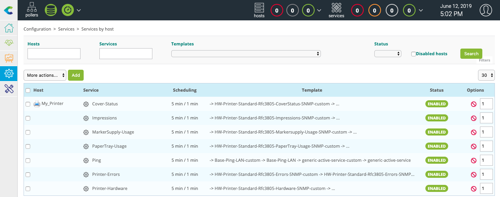

Rendez-vous dans le menu **Configuration > Connecteurs > Connecteurs de supervision**, recherchez **Printer Standard** puis cliquez sur l'icône **+** de la tuile du connecteur de supervision pour l'installer.

Rendez-vous maintenant dans le menu **Configuration > Hôtes > Hôtes** et cliquez sur le bouton **Ajouter**.

Renseignez les informations suivantes :

* **Nom** : le nom de votre serveur
* **Alias** : une description de votre serveur
* **Adresse** : son adresse IP
* **Communauté SNMP & Version** : la communauté et la version SNMP

Cliquez sur le bouton **+ Ajouter une nouvelle entrée** pour le champ **Modèles** puis
sélectionnez le modèle **HW-Printer-standard-rfc3805-custom**.

Cliquez sur le bouton **Sauvegarder**.

Votre équipement a été ajouté à la liste des hôtes dans **Configuration > Hôtes > Hôtes**.

Rendez-vous dans le menu **Configuration > Services > Services par hôte**. Un ensemble d'indicateurs a été déployé
automatiquement :

Il est maintenant temps de [déployer la supervision](first-supervision.md#déployer-une-configuration).

Rendez-vous ensuite dans le menu **Supervision > Statut des ressources** et sélectionnez **Toutes** dans le filtre **Statut des ressources**. Après quelques minutes, les premiers résultats de la supervision apparaissent.
