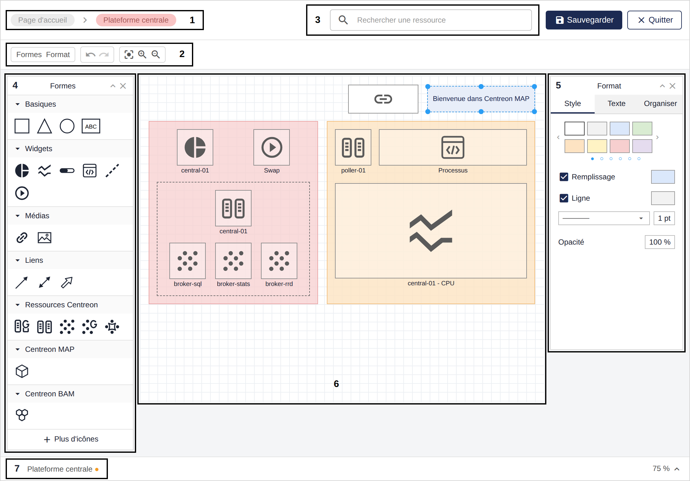

Cette page décrit comment créer des cartes standard et comment les personnaliser avec l'éditeur MAP.

Si le bouton **Ajouter une carte** s'affiche à la page **Supervision > Map**, vous appartenez à un groupe d'accès auquel le rôle de créateur est attribué et vous pouvez créer des cartes.

## Créer une carte standard

1. À la page **Supervision > Map**, cliquez sur le bouton **Ajouter une carte** situé dans la section **Cartes standard**.

2. Définissez les propriétés de la nouvelle carte :
   - Nom : saisissez un nom pour la carte.
   - Coordonnées géographiques : renseignez les champs au format `Latitude, Longitude`. Cela permet d'ajouter la carte à une [vue géographique](./map-web-create-geoview.md).
   - Image : sélectionnez une image si vous souhaitez personnaliser l'affichage de la carte dans la liste des cartes.

3. Cliquez sur **Ajouter** pour confirmer la création de la carte.

La nouvelle carte s'ouvre directement dans l'interface de l'éditeur.

## Créer une carte à partir d'un conteneur existant

Vous pouvez créer une carte directement à partir d'un [conteneur](#conteneur). Cela est utile lorsque vous souhaitez partager un niveau d'une carte avec d'autres utilisateurs sans dupliquer son contenu ni donner un accès complet à la carte principale.

1. Faites un clic droit sur le conteneur et cliquez sur **Créer une carte à partir d'un conteneur**.
2. Nommez le conteneur.
3. Cliquez sur **Ajouter**.

Votre carte a été créée. Vous pouvez la retrouver à la page **Map**.

> Vous pouvez maintenant personnaliser votre carte en utilisant les fonctionnalités de l'éditeur MAP.

## Utiliser l'éditeur MAP

Suivez cette procédure pour ouvrir votre carte en mode édition :

1. Allez à la page **Supervision > Map** pour afficher la liste des cartes existantes.
2. Sélectionnez la carte que vous souhaitez modifier.
3. Cliquez sur le bouton **Éditer** pour l'ouvrir en mode édition.

> Une fois vos modifications terminées, cliquez sur **Enregistrer** pour passer en mode visualisation, puis sur **Quitter**.

### Aperçu de l'éditeur MAP

Voici comment se présente l'éditeur MAP :

**1. Fil d'Ariane :** indique où vous vous trouvez dans la carte, lorsque celle-ci comporte plusieurs niveaux.
**2. Barre d'outils :** permet de masquer ou d'afficher des panneaux, d'annuler ou de rétablir des actions, et d'adapter, zoomer ou dézoomer l'espace de travail.
**3. Rechercher une ressource :** permet de rechercher des ressources à ajouter à votre carte.
**4. Panneau Formes :** ce panneau présente tous les éléments dont vous avez besoin pour concevoir une carte, des formes basiques aux ressources Centreon.
**5. Panneau Format :** ce panneau vous permet d'appliquer un format sur un élément sélectionné.
**6. Espace de travail :** c'est l'espace situé au milieu de l'éditeur, pour concevoir votre diagramme.
**7. Onglets :** permettent de naviguer entre les niveaux de votre carte. Chaque conteneur dispose de son propre onglet.

### Utiliser des éléments graphiques pour concevoir votre carte

Le panneau **Formes** contient différents types d'éléments pour concevoir votre carte. Les options s'affichent en fonction du type d'élément que vous avez sélectionné.

#### Éléments de base

Utilisez les formes de la section **Basiques** pour organiser vos éléments avec des formes géométriques et des zones de texte. Utilisez ensuite le panneau **Format** pour personnaliser votre forme en appliquant un format de style tel que la couleur, l'opacité, etc.

#### Éléments de widget

Utilisez les éléments **Widget** pour afficher des données graphiques sur les ressources que vous supervisez. Les widgets fournissent des informations telles que le statut ou des statistiques de performance. Les widgets disponibles sont les suivants :

- **Graphique à camembert :** affiche le statut d'une ressource sous forme de proportions. Il affiche :
  - Pour un hôte : le nombre de statuts OK, Alerte, Critique et NA.
  - Pour un groupe d'hôtes : le nombre d'hôtes en statut OK, Alerte, Critique et NA.
- **Graphique linéaire :** affiche les données de performance relatives à un service, sur une période de temps.
- **Jauge :** affiche une métrique sous forme de pourcentage. Vous devez définir une valeur maximale. Vous pouvez placer une jauge dans n'importe quelle direction (de gauche à droite, de bas en haut, etc.).
- **Output :** affiche la sortie d'un service. La couleur d'arrière-plan est celle du statut.
- **Processus :** permet de déclencher une action sur n'importe quelle ressource à l'aide d'une commande. Voici un exemple :
  - Vous avez un site internet interne qui utilise Apache, et Apache plante parfois. Vous devez trouver la cause de ces plantages, mais votre priorité est que le site reste accessible aux utilisateurs finaux.
  - Vous pouvez utiliser le widget Processus en lui attribuant une commande telle que `service httpd restart` : lorsque le processus Apache plante, les utilisateurs peuvent immédiatement redémarrer le service Apache à partir de la carte en double-cliquant sur le widget.
  - Pour créer un service dédié à une « action » : allez à la page **Configuration > Commandes > Contrôles**, cliquez sur **Ajouter** et créez une commande qui contient `service httpd restart` (n'oubliez pas d'activer le shell). Liez la commande à un service passif. Reliez le service passif à un hôte (par exemple, l'hôte qui héberge le site internet). Vous pouvez ensuite affecter ce service au widget.

#### Éléments médias

Utilisez les éléments de la section **Médias** pour ajouter :
- Une **URL** : ajoute un lien cliquable.
- Une **Image** : vous permet de personnaliser votre diagramme en ajoutant des images.

1. Faites glisser l'élément vers l'espace de travail.
2. Faites un clic droit dessus et sélectionnez **Modifier les paramètres...**.
3. Remplissez les paramètres requis et cliquez sur **Soumettre**.

#### Éléments de lien

Utilisez les éléments de la section **Liens** pour établir des liens entre les éléments (avec des points d'ancrage) :
- **Link :** une simple flèche qui relie deux éléments.
- **Status link :** utilisez ce lien entre deux éléments et configurez une ressource à superviser à partir de celui-ci. Le lien prend alors la couleur du statut de la ressource sélectionnée.
- **Metric link :** utilisez ce lien entre deux éléments et configurez un service ou un metaservice et ses métriques à partir de celui-ci. Le lien affiche alors les métriques du service ou du metaservice sélectionné.

#### Éléments Centreon

- Éléments de la section **Ressources Centreon** :
  - Host group
  - Host
  - Service
  - Service group
  - Metaservice

- Élément de la section **Centreon MAP** :
  - [Conteneur](#conteneur)

- Éléments de la section **Centreon BAM** :
  - Business activity

Les paramètres s'affichent en fonction du type d'élément que vous avez sélectionné.

1. Faites glisser l'élément vers l'espace de travail.
2. Faites un clic droit dessus et sélectionnez **Modifier les paramètres...**.
3. Remplissez les paramètres requis et cliquez sur **Soumettre**.

##### Conteneur

Utilisez des conteneurs lorsque vous souhaitez créer plusieurs niveaux de votre carte. Chaque niveau est représenté par un conteneur.
- En mode visualisation, chaque conteneur devient une carte avec son propre statut.
- En mode édition, chaque niveau devient un onglet. Vous pouvez alors naviguer entre les conteneurs à l'aide des différents onglets.

#### Personnaliser les éléments

Le panneau **Format** vous permet d'appliquer des options de formatage en fonction du type d'élément que vous avez sélectionné.
- Onglet **Style** : pour personnaliser les formes, les liens et le texte.
- Onglet **Texte** : pour mettre en forme tous les éléments de texte.
- Onglet **Organiser** : pour organiser les éléments dans l'espace de travail (taille, position, alignement) et les placer sur différents calques.
