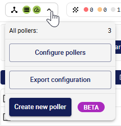
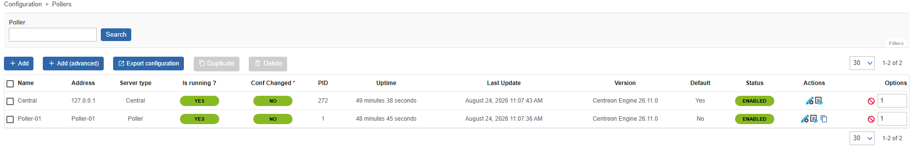

> La méthode de déploiement de collecteurs en conteneur est actuellement en **BÊTA**. Vous pouvez la tester et [donner votre feedback dans le groupe dédié sur notre plateforme communautaire The Watch](https://thewatch.centreon.com/groups/cim-pollers-in-containers-75).

Une commande d'installation prête à l'emploi et adaptée à votre plateforme est disponible depuis l'interface du serveur central.

<details>
<summary>Contenu des conteneurs</summary>

Les collecteurs en conteneur utilisent Debian 13.

Plutôt qu'un seul conteneur monolithique, chaque composant du collecteur s'exécute dans son
propre conteneur (Centreon Engine, Gorgone et, en option, la gestion des traps SNMP et la
supervision VMware), le tout orchestré par un unique fichier `docker-compose.yaml`.

Cette méthode de déploiement repose sur une commande d'installation générée, qui télécharge
puis exécute un script d'installation sur l'hôte des conteneurs. Le script génère pour vous les
fichiers `.env` et `docker-compose.yaml`, puis démarre l'ensemble des services.

> Voir [Utilisateurs et groupes](https://docs.centreon.com/docs/installation/technical/) pour connaître les
> utilisateurs système (`centreon-engine`, `centreon-gorgone`, etc.) utilisés dans ces conteneurs.

</details>

## Prérequis

* Sur le serveur central, [le module **pullwss** de Gorgone doit être configuré pour accepter les connexions](./pollers-containers-prerequisites.md). Cette opération n'est à réaliser qu'une seule fois, avant d'installer votre premier collecteur en conteneur.
* Un hôte Linux sur lequel l'un des moteurs de conteneurs suivants est installé :
  * **Docker Engine** et le plugin **Docker Compose v2** (la commande
    `docker compose version` doit aboutir).
  * **Podman** et `podman compose` ou `podman-compose`. Voir
    [Utiliser Podman](./using-containers-advanced-configuration.md#utiliser-podman)
    pour connaître les prérequis supplémentaires.
* Vous devez avoir créé un jeton d'authentification de type collecteur.
* Un accès réseau sortant depuis cet hôte vers votre serveur central Centreon : port web (443 pour HTTPS, 80 pour HTTP) et port TCP 5669 (Centreon Broker).
* Si vous prévoyez de recevoir des traps SNMP sur ce collecteur, le port UDP 162 doit être
  accessible sur cet hôte.
* Si vous prévoyez de superviser une infrastructure VMware depuis ce collecteur, une copie
  locale du dépôt `centreon-plugins` et les archives du SDK VMware doivent être présentes
  sur cet hôte (voir
  [Permettre au collecteur de superviser des ressources VMware](./using-containers-advanced-configuration.md#permettre-au-collecteur-de-superviser-des-ressources-vmware)).

## Étape 1 : Générer la commande d'installation

1. Sur le serveur central, cliquez sur la zone des collecteurs en haut à gauche de l'écran puis, dans la fenêtre qui s'ouvre, cliquez sur **Créer un collecteur**.

   

2. Renseignez les informations concernant le collecteur :

   * **Nom du collecteur** : un nom unique pour ce collecteur. Il apparaîtra dans la liste des collecteurs. Le nom ne doit contenir ni espaces ni caractères spéciaux, et le premier caractère doit être alphanumérique.
   * **Adresse du collecteur** : l'adresse de la machine hôte sur laquelle vous allez installer le collecteur.
      > L'adresse du collecteur n'a aucune incidence sur la connectivité : Gorgone
      > utilise PullWSS, c'est donc toujours le collecteur qui initie la connexion vers le
      > serveur central, et non l'inverse.
   * **Adresse du serveur central Centreon, telle que vue par ce collecteur** : l'URL que ce collecteur utilise pour joindre le serveur central, par exemple `http(s)://10.10.10.10/centreon`. Si votre serveur central est configuré en HTTPS, la connexion entre le serveur central et le collecteur sera automatiquement configurée en HTTPS aussi.

3. Sélectionnez **Conteneur** comme environnement du collecteur.

4. Sélectionnez le [jeton d'authentification](#prérequis) que vous avez créé pour ce collecteur.

5. Dans la section **Générer la commande d'installation**, cliquez sur le bouton et patientez le temps que la commande soit générée.

6. Copiez la commande à l'aide du bouton situé en haut à droite du bloc de code. Laissez la fenêtre ouverte : vous en aurez de nouveau besoin par la suite.

7. Ajoutez à la commande les [options facultatives](#services-optionnels-à-ajouter-à-la-commande-dinstallation) que vous souhaitez (par exemple pour permettre au collecteur de recevoir des données des agents CMA, ou pour superviser des ressources VMware. Dans les deux cas, vous devrez suivre les procédures correspondantes dans [Configuration avancée des conteneurs](./using-containers-advanced-configuration.md)).

8. Si vous souhaitez pouvoir utiliser les notifications par e-mail ou des plugins personnalisés, suivez les procédures correspondantes dans
[Configuration avancée des conteneurs](./using-containers-advanced-configuration.md).

## Étape 2 : Exécuter la commande d'installation sur l'hôte des conteneurs

1. Exécutez la commande copiée en tant qu'utilisateur autorisé à utiliser des conteneurs sur
l'hôte cible.

   > Si votre serveur central utilise HTTPS, l'hôte du conteneur doit faire confiance à son certificat. Si vous utilisez un certificat auto-signé, utilisez l'option `-k` (`--insecure`) de curl pour autoriser les connexions non sécurisées.

   <details>
   <summary>Ce que fait le script</summary>

   Le script :

   1. Détermine la commande compose à utiliser : `docker compose` si le démon Docker
      est joignable, sinon `podman compose`, sinon `podman-compose`. Avec Podman, il
      vérifie également les
      [prérequis de Podman](./using-containers-advanced-configuration.md#utiliser-podman).
   2. Génère un fichier `.env` et un fichier `docker-compose.yaml` dans le répertoire
      courant, ainsi qu'un fichier `.env.smtp` vide s'il n'existe pas encore. Si les
      fichiers `.env` ou `docker-compose.yaml` existent déjà, voir
      [Exécuter à nouveau la commande d'installation](#exécuter-à-nouveau-la-commande-dinstallation).
   3. Démarre les services avec la commande compose détectée (par exemple
      `docker compose up -d`), sauf si l'option `--no-start` a été ajoutée à la
      commande (dans ce cas, démarrez-les vous-même plus tard avec la même commande).

   Par défaut, deux services sont toujours générés :

   * **centengine** : Centreon Engine, le moteur de supervision.
   * **gorgone** : Gorgone, chargé de récupérer la configuration du collecteur et de
   communiquer avec le serveur central.

   **Référence des fichiers générés**

   Le fichier `docker-compose.yaml` généré par le script d'installation relie les services
   entre eux à l'aide de volumes Docker nommés : vous n'avez donc rien à configurer
   vous-même.

   | Volume | Utilisé par | Rôle |
   |--------|-----------------|---------|
   | `poller-etc` | gorgone, centreon-vmware | Configuration de Centreon (`/etc/centreon`) |
   | `poller-engine` | centengine, gorgone | Configuration de Centreon Engine (`/etc/centreon-engine`) |
   | `poller-broker` | centengine, gorgone | Configuration de Centreon Broker (`/etc/centreon-broker`) |
   | `poller-centcmd` | centengine, gorgone, centreontrapd | Pipe de commandes externes de Centreon Engine (`/var/lib/centreon-engine/rw`) |
   | `poller-centlog` | centengine | Logs de Centreon Engine (`/var/log/centreon-engine`) |
   | `poller-gorgone-data` | gorgone | Données de Gorgone (`/var/lib/centreon-gorgone`) |
   | `poller-snmp-spool` | snmptrapd, centreontrapd | Répertoire de spool dans lequel les traps reçus sont écrits, puis traités |
   | `poller-snmp-traps` | gorgone, centreontrapd | Définitions des traps SNMP transmis par le serveur central |
   | `poller-cma-pki` | centengine | Autorité de certification utilisée pour les connexions des agents CMA (`/etc/pki/centreon-engine`), uniquement avec `--with-cma` |

   Chaque service dispose également d'un healthcheck Docker : la commande
   `docker compose ps` indique donc `healthy` dès qu'un service est complètement démarré.

   </details>

2. Vérifiez l'état de santé du conteneur `gorgone` sur l'hôte des conteneurs :

   ```shell
   docker compose ps
   ```

   > Si vous utilisez Podman, remplacez `docker compose` par `podman compose` ou
   > `podman-compose` dans les commandes de cette page.

   Dès que `gorgone` indique `healthy`, la connexion au serveur central est établie.

   Si `gorgone` n'atteint pas l'état `healthy` au bout de quelques minutes, consultez ses logs
(`docker compose logs gorgone`), puis reportez-vous aux pages
[Rattacher un collecteur à un serveur central ou distant](../../monitoring/monitoring-servers/add-a-poller-to-configuration.md)
et [Communications entre serveurs](../../monitoring/monitoring-servers/communications.md)
pour en savoir plus sur la façon dont les collecteurs s'enregistrent et communiquent avec le
serveur central.

## Étape 3 : Exporter la configuration

Sur le serveur central, revenez à la fenêtre de création du collecteur et cliquez sur
**Exporter la configuration**.

Le collecteur apparaît alors comme actif à la page **Configuration > Collecteurs** :



## Étape 4 : Sécuriser votre plateforme

Si votre serveur central est configuré en HTTPS, la connexion entre le serveur central et le collecteur sera automatiquement configurée en HTTPS aussi. Pensez cependant à effectuer les autres actions de sécurisation de votre plateforme Centreon en suivant nos
[recommandations](../../administration/secure-platform.md).

## Services optionnels à ajouter à la commande d'installation

La commande générée de base ressemble à ceci :

```shell
curl -fsSL <CENTRAL_URL>/poller/install.sh | bash -s -- \
   --type docker \
   --poller_token <TOKEN_NAME>:<TOKEN_SECRET> \
   --uid <POLLER_UID> \
   --name '<POLLER_NAME>' \
   --central_url <CENTRAL_URL> \
   --appsecret <APP_SECRET> \
   --salt <SALT>
```

Ajoutez les options suivantes à la commande d'installation pour inclure des fonctionnalités supplémentaires :

| Option | Effet |
|------|--------|
| `--with-snmptrap` | Ajoute les services `snmptrapd` et `centreontrapd`, pour la supervision passive via les [traps SNMP](../../monitoring/passive-monitoring/enable-snmp-traps.md). |
| `--with-vmware` | [Permet au collecteur de superviser des ressources VMware](using-containers-advanced-configuration.md#permettre-au-collecteur-de-superviser-des-ressources-vmware) (ajoute au docker-compose le service `centreon-vmware`, construit localement à partir d'une copie locale du dépôt `centreon-plugins`). |
| `--vmware-path <chemin>` | Chemin de la copie locale du dépôt `centreon-plugins` utilisée pour construire l'image `centreon-vmware` (par défaut : `./centreon-plugins`). Utilisée uniquement avec `--with-vmware`. |
| `--with-cma` | [Permet au collecteur de recevoir des données des agents CMA](./using-containers-advanced-configuration.md#permettre-au-collecteur-de-recevoir-des-données-des-agents-cma). Conserve l'autorité de certification CMA du collecteur dans un volume persistant et expose le port 4317, pour les collecteurs qui acceptent les connexions de l'agent CMA (Centreon Monitoring Agent) via OpenTelemetry gRPC. |
| `--cma-hostname <nom d'hôte>` | Nom d'hôte du conteneur `centengine`, également utilisé comme nom dans l'autorité de certification CMA du collecteur (par défaut : `centengine`). Indiquez le nom d'hôte que les agents utilisent pour joindre le collecteur. Utilisée uniquement avec `--with-cma`. |
| `--tz <timezone>` | Définit le fuseau horaire des conteneurs (par défaut : `UTC`). |
| `--debug true` | Active les logs de débug sur les services. |
| `--gorgone-ssl <true\|false>` | Remplace le paramètre SSL utilisé pour la connexion de Gorgone au serveur central (par défaut : HTTPS si le serveur central utilise déjà HTTPS). |
| `--no-start` | Génère uniquement les fichiers `.env` et `docker-compose.yaml` ; ne démarre pas les services. |
| `--overwrite` | Remplace les fichiers `.env` et `docker-compose.yaml` existants sans demander de confirmation. À utiliser pour les exécutions non interactives (scripts, automatisation). |

Si vous avez déjà exécuté la commande d'installation sans ces options, vous pouvez également
ajouter le ou les services correspondants à la main dans les fichiers `docker-compose.yaml`
et `.env` générés, puis exécuter de nouveau `docker compose up -d`.

## Exécuter à nouveau la commande d'installation

Si les fichiers `.env` ou `docker-compose.yaml` existent déjà dans le répertoire
courant, la commande d'installation ne les remplace pas sans prévenir :

* Dans un terminal interactif, elle vous demande si vous souhaitez les remplacer.
* Si vous répondez non, ou si la commande s'exécute sans terminal (par exemple
  depuis un script), elle écrit le nouveau contenu dans les fichiers `.env.new` et
  `docker-compose.yaml.new`, et ne démarre pas les services. Comparez-les avec vos
  fichiers actuels (`diff .env .env.new`), puis remplacez les deux fichiers en même
  temps.
* Avec `--overwrite`, elle remplace les deux fichiers sans demander de confirmation.

Toute modification manuelle des fichiers `.env` ou `docker-compose.yaml` (plugins
personnalisés, volumes supplémentaires, etc.) est perdue lorsqu'ils sont remplacés :
sauvegardez-les au préalable. Le fichier `.env.smtp` n'est jamais remplacé.

> Dans Centreon 26.10.0, la commande d'installation remplace les fichiers `.env` et
> `docker-compose.yaml` sans avertissement.
