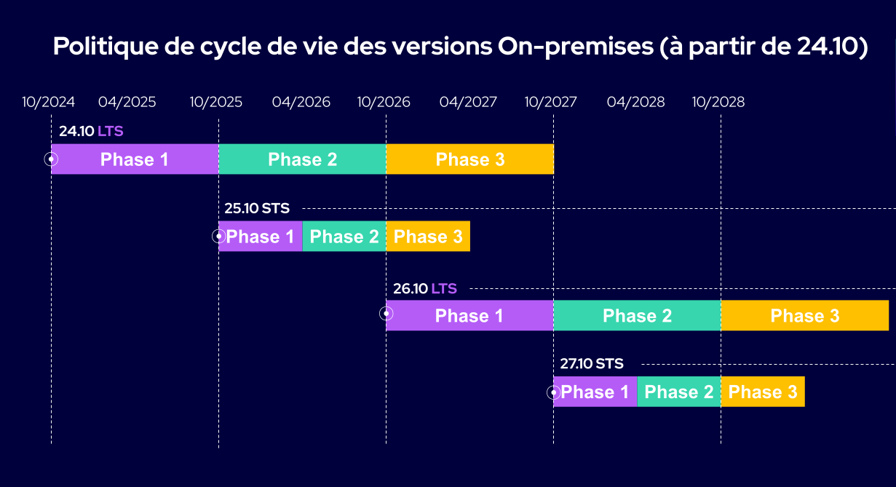

import Tabs from '@theme/Tabs';
import TabItem from '@theme/TabItem';

La société Centreon publie de nouvelles versions
de Centreon sur une cadence régulière depuis Centreon 18.10, permettant à la communauté, aux
entreprises et aux développeurs de planifier leurs feuilles de route avec la
certitude d’avoir de la visibilité en amont sur les nouvelles capacités offertes par l'open source.

## Numéros de version

Les versions de Centreon sont nommées par l'année et la période de livraison. Par
exemple, Centreon 22.10 a été livrée en octobre 2022. Tous les modules et
composants de la collection de logiciels Centreon possèdent le même numéro de
version.

## Cadence de publication

- À partir de Centreon 24.10, Centreon publiera **une version majeure par an**.
- Des versions mineures, avec des corrections de bugs et des améliorations mineures, sortiront sur une base mensuelle.
- Une version Service Pack, cumulant toutes les modifications des versions mineures, sera généralement livrée après six mois.

## Mises à jour de maintenance et de sécurité

- Toutes les versions majeures Open Source sont supportées pendant 18 mois.
- Les versions commerciales majeures de 2024, 2026 et toutes les années paires sont des versions LTS (supportées pendant 3 ans).
- Les versions commerciales majeures de 2025, 2027 et toutes les années impaires sont supportées pendant 18 mois.

## Cycle de vie

Le cycle de vie d'une version est divisé en 3 phases :

1. Première phase : bugs de toute criticité (minor, major, critical, blocking) et correction de sécurité seront traités par priorité. Des améliorations fonctionnelles seront ajoutées.
2. Seconde phase : bugs et correction de sécurité de criticité major, critical et blocking seront traités par priorité.
3. Troisième phase : bugs bloquants et correction de sécurité seront traités par priorité. Une vulnérabilité dont le délai de remédiation dépasse la date de fin de support de la version n'est pas corrigée sur cette version: passez à une version supportée pour bénéficier du correctif.

> Les vulnérabilités sont traitées selon un [plan de remédiation CVSS v3](../security/security.md#notation-des-vulnérabilités). Les bugs sont priorisés par l'équipe Produit Centreon.

La première phase du cycle de vie commence le jour de la sortie de la version.

La deuxième phase d'une version commence lorsque la prochaine version majeure est disponible. Par exemple, la publication de Centreon 25.10 lance la deuxième phase de Centreon 24.10.

La troisième phase d'une version commence lorsque la deuxième version majeure suivante est disponible. Par exemple, la sortie de Centreon 26.10 lance la troisième phase de Centreon 24.10 et de Centreon 25.10.

### Schéma

Le schéma suivant présente le cycle de vie des produits Centreon à partir de la version 24.10 :

## Dépendances tierces

Centreon ne gère pas le cycle de vie des dépendances tierces telles que MariaDB ou MySQL, PHP et Java.
Centreon s’appuie sur les paquets fournis par le système d’exploitation via ses dépôts officiels.

Si la fin de vie de l'une de ces dépendances arrive à échéance avant la fin de vie de votre version de Centreon Infra Monitoring, Centreon mettra à jour son socle logiciel pour utiliser une version plus récente, si possible via les dépôts officiels de l’OS. Centreon préviendra ses utilisateurs via un bulletin de sécurité sur [TheWatch](https://thewatch.centreon.com/) afin que les administrateurs système puissent mettre à jour leur socle logiciel Centreon et les dépendances associées.

Le tableau suivant présente l'état des principales dépendances de Centreon 27.10 sur chaque système d'exploitation supporté :

| Dépendance (fin de support amont) | EL 9 (RHEL/OL/Alma) | EL 10 (RHEL/OL/Alma) | Debian 13 |
|-----------------------------------|---------------------|----------------------|-----------|
| **OS** | ✅ 2032 | ✅ 2035 | ✅ Sécurité Debian jusqu'en août 2028, puis uniquement Debian LTS |
| **PHP 8.4** (sécurité jusqu'au 31/12/2028) | ⚠️ Passage prévu en PHP 8.5 ou 8.6, suivant ce qui sera fourni en standard par l'OS | ⚠️ Passage prévu en PHP 8.5 ou 8.6, suivant ce qui sera fourni en standard par l'OS | ✅ C'est le PHP fourni par Debian, donc correctifs Debian puis LTS jusqu'en 2030 |
| **MySQL 8.4 LTS** (Premier jusqu'au 30/04/2029, Extended jusqu'au 30/04/2032) | ⚠️ Passage prévu en 9.7 LTS ou version supérieure, suivant ce qui sera fourni en standard par l'OS | ⚠️ Passage prévu en 9.7 LTS ou version supérieure, suivant ce qui sera fourni en standard par l'OS | ⚠️ Passage prévu en 9.7 LTS ou version supérieure, suivant ce qui sera fourni en standard par l'OS |
| **MariaDB 11.8 LTS** (communautaire jusqu'au 04/06/2028) | ⚠️ Passage prévu en version LTS supérieure, suivant ce qui sera fourni en standard par l'OS | ⚠️ Passage prévu en version LTS supérieure, suivant ce qui sera fourni en standard par l'OS | ✅ C'est la version fournie par Debian, donc couverte par Debian puis LTS |
| **Java 25 LTS** (Temurin sept. 2031, Red Hat déc. 2030) | ✅ | ✅ | ✅ |

## Tableau de maintenance des versions

> Tous les autres produits non décrits dans les tableaux suivants ne sont plus
> pris en charge par Centreon.

| Produit        | Sortie       | Date de fin de support    | État                |
|----------------|--------------|---------------------------|---------------------|
| Centreon 26.10 | 10/2026      | 10/2029                   | Supportée           |
| Centreon 25.10 | 10/2025      | 04/2027                   | Supportée           |
| Centreon 24.10 | 10/2024      | 10/2027                   | Supportée           |
| Centreon 24.04 | 04/2024      | 04/2026                   | Plus supportée      |
| Centreon 23.10 | 10/2023      | 10/2025                   | Plus supportée      |
| Centreon 23.04 | 04/2023      | 04/2025                   | Plus supportée      |
| Centreon 22.10 | 10/2022      | 10/2024                   | Plus supportée      |
| Centreon 22.04 | 05/2022      | 05/2024                   | Plus supportée      |
| Centreon 21.10 | 11/2021      | 11/2023                   | Plus supportée      |
| Centreon 21.04 | 04/2021      | 10/2022                   | Plus supportée      |
| Centreon 20.10 | 10/2020      | 05/2022                   | Plus supportée      |
| Centreon 20.04 | 04/2020      | 10/2021                   | Plus supportée      |
| Centreon 19.10 | 10/2019      | 04/2021                   | Plus supportée      |
| Centreon 19.04 | 04/2019      | 10/2020                   | Plus supportée      |
| Centreon 18.10 | 10/2018      | 04/2020                   | Plus supportée      |
