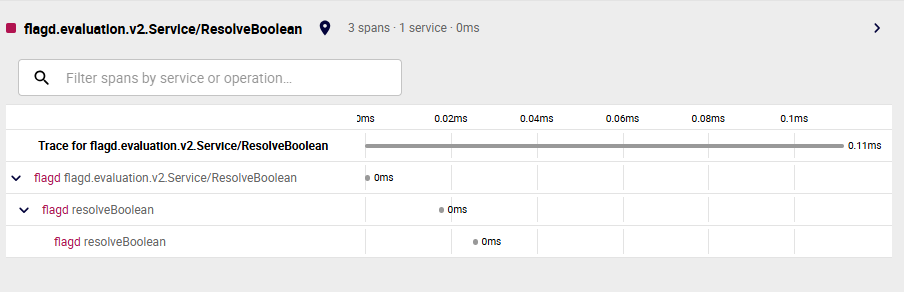

## What is a trace?

When something happens in an application, for example when a user clicks a button, it often sets off a whole chain of actions behind the scenes, across several services. A trace is the complete record of that journey, from start to finish.

Each step along the way, such as a database query or a call to another service, is called a span. All the spans of the same journey share an identifier, the **trace_id**, which links them together into a single trace, even when the steps run in different services.

A trace shows you what happened, where it happened and how long each step took. When a request is slow or fails, the trace tells you where the time went or where things broke.

Traces are listed in the **Trace explorer** page, and you can filter or search for data in this view [just like in the Log explorer](../log-explorer.md#searching-for-logs).

## What is a span?

A span represents the execution of a specific operation within a trace: a database query, a call to another service, a calculation, etc. Each span has:

* a name
* a start and end timestamp, used to calculate its duration
* its own identifier, the **span_id**
* the **trace_id** of the trace it belongs to.

The spans of a trace are organized in a parent-child relationship: a span can trigger another one, for example when one service calls a second one. Each child span carries its parent's spanId in the parentSpanId field. These links rebuild the complete sequence of operations and show exactly where a slowdown or an error occurred.

The span that has no parent is called the root span: it is the one that starts the trace.

## The waterfall view of a trace

Traces are usually displayed as a waterfall view: each bar represents a span, its length matches its duration, and child spans are indented under their parent. Here is what the waterfall view of a trace looks like in Log Management:



## Does a trace always match a request?

A request is something asked of the system: a click, a page load, an API call. Most of the time, one request matches one trace, but not always.

Take an example: a user opens a page of an online store. Loading this page triggers a whole chain of actions behind the scenes. The server receives the request, fetches the user's information from a database, queries one service to get the product catalog and another one for the shopping cart, and finally puts everything together to send back the page. If the page takes 3 seconds to display, the trace of this request shows the time spent at each step.

This is the most common case: a user makes a request, the system processes it and responds. One request, one trace.

However, a trace follows an operation, not a request: it can include tasks that run later, such as a confirmation email sent after an order, and a single request can be split into several traces if a service doesn't pass the trace context on (see [Context propagation](#context-propagation)).

## Difference between a trace and a TRACE-level log

Despite their name, these two concepts are unrelated. TRACE is the most detailed severity level of a log, below DEBUG: it is used to record very fine-grained information about code execution. A trace, in the observability sense, is the record of an operation's journey across several services.

So a TRACE-level log is not part of a trace, and a log of any severity can be linked to a trace.

## Correlation between traces and logs

A log record has optional **TraceId** and **SpanId** fields, populated from the active context when the log is emitted. That's what lets Log Management show you "the logs that happened during this span": navigate [from logs to traces](exploring.md#go-from-a-log-to-its-trace) and [from traces to logs](exploring.md#go-from-a-trace-to-logs).

## Example: a parent span and its child span

In this example, a service receives an order (**process_order**), then calls a payment service (**charge_payment**).

The examples below follow the OpenTelemetry OTLP/JSON format, slightly simplified for readability: the values of **kind** and **status.code** are shown by their name rather than their numeric value.

### Parent span

```json
{
  "traceId": "5b8aa5a2d2c872e8321cf37308d69df2",
  "spanId": "051581bf3cb55c10",
  "name": "process_order",
  "kind": "SPAN_KIND_SERVER",
  "startTimeUnixNano": "1657891199950000000",
  "endTimeUnixNano": "1657891200400000000",
  "attributes": [
    { "key": "http.method", "value": { "stringValue": "POST" } },
    { "key": "http.route", "value": { "stringValue": "/api/orders" } },
    { "key": "order.id", "value": { "stringValue": "ORD-48213" } }
  ],
  "status": {
    "code": "STATUS_CODE_OK"
  }
}
```

* **startTimeUnixNano** and **endTimeUnixNano** are timestamps in nanoseconds since the Unix epoch. The difference between them gives the span's duration: 450 ms.
* **attributes** contains metadata as typed key/value pairs (HTTP method, route, business identifier…). See [Attributes and resource](#attributes-and-resource).
* This parent span has no `parentSpanId`: it is the root span of the trace (the one that starts it). If it had been triggered by another span (for example on the browser side or by an API gateway), it would carry that span's **spanId** in **parentSpanId**.

### Child span

```json
{
  "traceId": "5b8aa5a2d2c872e8321cf37308d69df2",
  "spanId": "051581bf3cb55c13",
  "parentSpanId": "051581bf3cb55c10",
  "name": "charge_payment",
  "kind": "SPAN_KIND_CLIENT",
  "startTimeUnixNano": "1657891200000000000",
  "endTimeUnixNano": "1657891200340000000",
  "attributes": [
    { "key": "http.method", "value": { "stringValue": "POST" } },
    { "key": "http.url", "value": { "stringValue": "https://payment-service/api/charge" } },
    { "key": "http.status_code", "value": { "intValue": "200" } }
  ],
  "status": {
    "code": "STATUS_CODE_OK"
  }
}
```

* **parentSpanId** contains the spanId of the process_order span: this is what makes it its child.

### What links the two spans

* Both spans have the same **traceId** (**5b8aa5a2d2c872e8321cf37308d69df2**): they belong to the same trace.
* The **parentSpanId** of **charge_payment** is equal to the **spanId** of **process_order** (**051581bf3cb55c10**). This link is what lets the visualization tool rebuild the tree:

    ```text
    process_order (051581bf3cb55c10)          [SERVER, 450 ms]
    └── charge_payment (051581bf3cb55c13)    [CLIENT, 340 ms]
    ```

* The parent's time range covers the child's: **charge_payment** starts 50 ms after **process_order** and lasts 340 ms. This is the usual case for a synchronous call. In asynchronous processing (message queue, deferred task), however, a child span can end after its parent.

## Attributes and resource

A span's **attributes** are key/value pairs that describe the operation: HTTP method, route called, response code, SQL query, order ID, etc. OpenTelemetry defines standard names for the most common attributes (the **semantic conventions**), for example `http.request.method` or `http.response.status_code`. You can also add your own business attributes, such as `order.id` in the example above.

The **resource** describes the entity that produced the span: the service, its version, and the host or container it runs on. Its attributes, such as `service.name` or `host.name`, are shared by all the spans emitted by that service.

Attributes and the resource are what let you filter, group and analyze traces: for example, to display all the traces of a given service, or all the requests that returned a 500 error.

## Span status

Each span carries a status that indicates whether the operation succeeded:

* `UNSET`: default value, no status was explicitly set. The operation is considered successful.
* `OK`: the operation was explicitly marked as successful.
* `ERROR`: the operation failed.

The status lets you quickly spot the spans in error in a trace, and so find the step where a problem appeared.

## Context propagation

For spans emitted by different services to be linked to the same trace, the `traceId` and the `spanId` of the current span must be passed from one service to the next. This is called **context propagation**.

In an HTTP call, this context is passed in the `traceparent` header, defined by the W3C Trace Context standard:

```text
traceparent: 00-5b8aa5a2d2c872e8321cf37308d69df2-051581bf3cb55c13-01
```

This header contains the format version, the `traceId`, the `spanId` of the calling span, and flags (for example, whether the trace is sampled). The called service reads this header and creates its own spans with the same `traceId`, using the received `spanId` as their `parentSpanId`.

OpenTelemetry SDKs handle this propagation automatically for most HTTP, gRPC and messaging libraries. If a service in the chain is not instrumented or does not pass the context on, the trace is split into several pieces.
