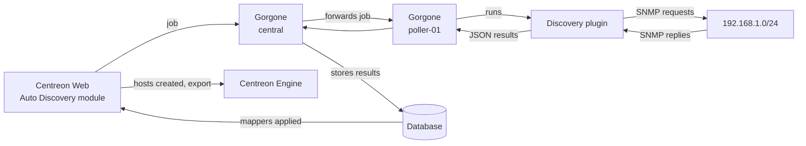

## Journey of a discovery job: finding Linux servers with SNMP

This topic follows a host discovery job from the moment you create it in Centreon Web to the moment the discovered hosts are monitored. It uses an SNMP discovery of Linux servers on a subnet as an example.

## Example used in this topic

| Item | Value |
|------|-------|
| Discovery provider | Generic SNMP agents |
| Subnet scanned | `192.168.1.0/24` |
| SNMP version and community | `2c` / `public` |
| Poller running the discovery | `poller-01` |
| Host found | `srv-linux-01` (`192.168.1.20`) |
| Host template applied | `OS-Linux-SNMP-custom` |

> **Note:** Provider names, plugin options and attribute names depend on your Monitoring Connector version. The commands and outputs below are simplified examples.

## Overview



## Step 1: Create the discovery job

Go to **Configuration > Hosts > Discovery** and click **+ADD**. A wizard opens:

1. **Choose a provider**: select **Generic SNMP agents**. Providers come with Monitoring Connectors, so the matching connector must be installed.
2. **Access parameters**: enter the SNMP version (`2c`) and community (`public`).
3. **Additional parameters**: enter the subnet to scan (`192.168.1.0/24`) and select the poller that will run the discovery (`poller-01`). The poller must be able to reach the subnet.
4. **Mappers**: define how discovered items become hosts (see [Step 7](#step-7-mappers-turn-results-into-hosts)).
5. **Analysis**: choose **Manual analysis** (you select the hosts to create) or **Automatic analysis** (hosts are created automatically).
6. **Execution**: run the job immediately or schedule it.

Click **FINISH**. The job appears in the list with the status **Scheduled** or **Running**.

## Step 2: Centreon Web hands the job to Gorgone

The Auto Discovery module sends the job to the Gorgone daemon on the central server. Gorgone builds the discovery command from the provider definition and the parameters you entered.

## Step 3: Gorgone forwards the job to the poller

Because the job is assigned to `poller-01`, Gorgone on the central server forwards it to Gorgone on `poller-01`. The discovery runs on the poller, close to the network being scanned. The central server doesn't need to reach the subnet itself.

## Step 4: The poller runs the discovery plugin

Gorgone on `poller-01` runs the discovery plugin. The command looks like this (simplified):

```text
/usr/lib/centreon/plugins/centreon_generic_snmp.pl --plugin=os::linux::snmp::plugin \
  --mode=discovery --subnet='192.168.1.0/24' \
  --snmp-community='public' --snmp-version='2c' --snmp-port='161'
```

## Step 5: The plugin scans the subnet

The plugin sends an SNMP request to every address of the subnet. Addresses where an SNMP agent answers are kept. For each one, the plugin reads basic system information, such as the system name and description, and deduces the type of device.

```text
poller-01 → SNMP get sysDescr, sysName → 192.168.1.1 … 192.168.1.254
poller-01 ← reply from 192.168.1.20: "Linux srv-linux-01 5.14.0 x86_64"
poller-01 ← reply from 192.168.1.21: "Cisco IOS Software …"
(no reply from the other addresses)
```

## Step 6: The results come back to the central server

The plugin returns its results as JSON. Gorgone on the poller sends them back to Gorgone on the central server, which stores them in the database. The job status changes to **Finished**.

```json
{
  "discovered_items": 2,
  "results": [
    {
      "ip": "192.168.1.20",
      "hostname": "srv-linux-01",
      "type": "linux",
      "description": "Linux srv-linux-01 5.14.0 x86_64",
      "snmp_community": "public",
      "snmp_version": "2c",
      "snmp_port": 161
    },
    {
      "ip": "192.168.1.21",
      "hostname": "sw-core-01",
      "type": "cisco",
      "description": "Cisco IOS Software …",
      "snmp_community": "public",
      "snmp_version": "2c",
      "snmp_port": 161
    }
  ]
}
```

## Step 7: Mappers turn results into hosts

The Auto Discovery module applies the job's mappers to each result. Mappers translate discovered attributes into Centreon host settings:

| Mapper | Rule in this example | Result for `srv-linux-01` |
|--------|---------------------|---------------------------|
| Property | Name ← `hostname`, address ← `ip` | Name `srv-linux-01`, address `192.168.1.20` |
| Exclusion | Exclude if `type` is not `linux` | `sw-core-01` is excluded |
| Template | Add `OS-Linux-SNMP-custom` | Template applied |
| Host group | `os-` + `type` | Linked to host group `os-linux` (created if it doesn't exist) |
| Monitoring | Monitored from `poller-01` | Assigned to `poller-01` |

If you change mappers before the hosts are created, the results are updated immediately.

## Step 8: You review the results

On **Configuration > Hosts > Discovery**, click the arrow next to the job's status to display the results. An icon tells you what will happen to each host:

- **Plus icon**: the host doesn't exist yet and will be created.
- **Arrow icon**: the host already exists and will be updated (only if **Update existing hosts** was selected).

With **Manual analysis**, select `srv-linux-01` and click **Save**. With **Automatic analysis**, this step happens on its own. The job goes through the **Saving** status.

## Step 9: The hosts are created

`srv-linux-01` is created in **Configuration > Hosts > Hosts**. The services linked to its host template (CPU, memory, disks, traffic and so on) are created with it.

## Step 10: The configuration is exported

Export the configuration of `poller-01` and reload it. If **Export and reload pollers configuration** was selected in the job wizard, this happens automatically. Centreon Engine on `poller-01` now knows about `srv-linux-01` and starts scheduling its checks.

From here, each check follows the journey described in [Journey of a check: a ping on a Linux server](check-workflow.md).

## Discovery versus checks

A discovery job and a monitoring check both run plugins on a poller, but they follow different paths:

| | Discovery job | Monitoring check |
|---|---|---|
| Triggered by | You, or the job's schedule | Centreon Engine, at each check interval |
| Run by | Gorgone | Centreon Engine |
| Plugin output | JSON list of discovered items | Exit code, output and performance data |
| Results go to | Auto Discovery module, then host configuration | Centreon Broker, then real-time status and graphs |
| Uses Centreon connectors | No | Yes, if one is set on the command |

Because discovery commands are run by Gorgone and not by Centreon Engine, Centreon connectors play no part in discovery. They only apply to monitoring checks.

## Behavior to keep in mind

- Hosts that are no longer discovered are **not** disabled automatically. Only hosts that are discovered and excluded by an exclusion mapper can be disabled.
- When existing hosts are updated, their name, alias and IP address (set by Property mappers) are not changed.
- Changing mappers after hosts have been created has no effect on those hosts, unless **Update existing hosts** is selected.