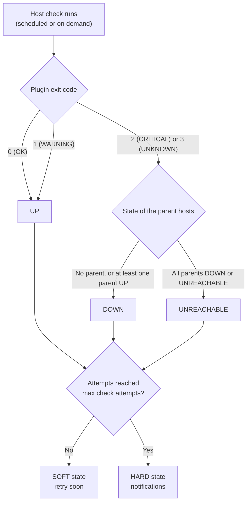

---
id:workflow-host-check
title: How the status of a host is computed
description: "Learn how Centreon Engine turns a host check result into an UP, DOWN or UNREACHABLE status, using parent hosts and SOFT and HARD states."
---

This topic explains how Centreon Engine decides whether a host is UP, DOWN or UNREACHABLE, and when that status is confirmed.

The key point: **a host's status comes from its own check command, not from its services.** A host can be UP while all its services are CRITICAL.

## Example used in this topic

| Item | Value |
|------|-------|
| Host | `srv-linux-01` (`192.168.1.20`) |
| Parent host | `rtr-site-a` (the router in front of the server) |
| Host check command | `base_host_alive` (runs `check_icmp`) |
| Check interval | 5 minutes |
| Retry check interval | 1 minute |
| Max check attempts | 3 |

## Overview



## Possible host statuses

| Status | Meaning |
|--------|---------|
| PENDING | The host has not been checked yet |
| UP | The host answers its check |
| DOWN | The host doesn't answer, and the network path to it is working |
| UNREACHABLE | The host can't be checked because every path to it goes through a failed parent host |

> **Note:** Don't confuse plugin exit codes with host status codes. A plugin returns `0` (OK), `1` (WARNING), `2` (CRITICAL) or `3` (UNKNOWN). Centreon then stores host statuses with their own codes: `0` (UP), `1` (DOWN), `2` (UNREACHABLE). A host status of `1` therefore means DOWN, not WARNING.

## Step 1: Centreon Engine runs the host check

Centreon Engine runs the host's check command in these situations:

- **Scheduled checks**: every check interval (5 minutes here), or every retry check interval (1 minute) while a problem is being confirmed. If the check interval is `0`, no regular checks are scheduled.
- **On-demand checks**: when a service of the host changes state. For example, if a service of `srv-linux-01` goes CRITICAL, Centreon Engine checks the host to know whether the whole server is down.
- **Reachability checks**: when a host goes down, Centreon Engine may check its parent hosts to find out where the failure is (see [Step 3](#step-3-down-or-unreachable)).

For `srv-linux-01`, the check runs:

```text
/usr/lib/nagios/plugins/check_icmp -H 192.168.1.20 -w 3000.0,80% -c 5000.0,100% -p 1
```

The journey of this command, from scheduling to execution, is described in [Journey of a service check](./workflow-service-check.md).

## Step 2: The exit code gives a preliminary state

Centreon Engine translates the plugin's exit code into a preliminary host state:

| Plugin exit code | Preliminary host state |
|------------------|------------------------|
| `0` (OK) | UP |
| `1` (WARNING) | UP |
| `2` (CRITICAL) | DOWN |
| `3` (UNKNOWN) | DOWN |

A host has no WARNING status: a WARNING result means the host is UP. If aggressive host checking (`use_aggressive_host_checking`) is enabled on the poller, a WARNING result means DOWN instead.

If the preliminary state is UP, it is final. If it is DOWN, Centreon Engine goes on to Step 3.

## Step 3: DOWN or UNREACHABLE

A server that doesn't answer may be down, or the router in front of it may have failed. To tell the difference, Centreon Engine looks at the host's **parent hosts** (the **Parent hosts** field of the host configuration):

| Preliminary state | Parent hosts | Final state |
|-------------------|--------------|-------------|
| DOWN | No parent | DOWN |
| DOWN | At least one parent is UP | DOWN |
| DOWN | All parents are DOWN or UNREACHABLE | UNREACHABLE |

In this example:

- `srv-linux-01` stops answering and `rtr-site-a` is UP: the server itself has a problem. `srv-linux-01` is **DOWN**.
- `srv-linux-01` stops answering and `rtr-site-a` is DOWN: the server may be fine, but it can't be reached. `srv-linux-01` is **UNREACHABLE**.

This lets you go straight to the root cause during an outage: the router, not the dozens of hosts behind it. If no parent hosts are defined, a host is never UNREACHABLE, and a network failure shows as many DOWN hosts.

## Step 4: SOFT or HARD

A new state is not trusted straight away. Centreon Engine confirms it by checking again, up to **Max check attempts** times:

- **SOFT**: a change has been detected but not confirmed. Checks run at the retry check interval.
- **HARD**: the state is confirmed. Checks go back to the normal check interval.

Example with a check interval of 5 minutes, a retry interval of 1 minute and 3 max check attempts:

| Time | Attempt | Status | State type | What happens |
|------|---------|--------|------------|--------------|
| t+0 | 1/3 | UP | HARD | Normal situation |
| t+5 | 1/3 | DOWN | SOFT | First failed check. Event handlers run. Next check in 1 minute. |
| t+6 | 2/3 | DOWN | SOFT | Still failing. Event handlers run. |
| t+7 | 3/3 | DOWN | HARD | Max check attempts reached. The DOWN state is confirmed and a problem notification is sent. |
| t+12 | 3/3 | DOWN | HARD | Still down. Further notifications depend on the notification interval. |
| t+17 | 1/3 | UP | HARD | The host answers again: recovery notification. |

If the host answers again while still SOFT (for example, at t+6), it returns to UP without sending any notification: it was a short glitch, not a real outage.

In **Monitoring > Resources Status**, the **Tries** column shows the current attempt (for example, `2/3`) and whether the state is SOFT or HARD.

## Step 5: What a HARD state triggers

When a host enters a HARD problem state or recovers from one:

- **Notifications** are sent to the host's contacts, according to its notification options. DOWN, UNREACHABLE and recovery notifications can be enabled separately, so you can, for example, not notify for UNREACHABLE hosts and only notify for the failed parent.
- **Event handlers** run. They also run on SOFT state changes.
- The status is sent by Centreon Broker to the central server and displayed in Centreon Web, as described in [Journey of a service check](./workflow-service-check.md).

## What doesn't change the host status

| Element | Effect on the host status |
|---------|---------------------------|
| The host's services | None. Services can only trigger an on-demand host check. Their own statuses don't count. |
| Acknowledgement | None. The status stays DOWN; only notifications stop and the problem is marked as handled. |
| Downtime | None. The status is still computed; notifications are suppressed during the downtime. |
| Flapping | None. The status keeps changing, but the host is flagged as flapping and notifications are suppressed. |

## Common questions

**All the services of my host are CRITICAL, but the host is UP. Is this a bug?**
No. The host status only reflects its own check command, usually a ping. The server answers pings, so it is UP, even if the applications on it fail.

**My host is UNREACHABLE, but the server is running.**
At least one of its parent hosts is DOWN or UNREACHABLE. Check the parents first, then check that the parent relationships in the configuration match your real network.

**My host check plugin returns WARNING, but the host is UP.**
This is expected: host checks have no WARNING state, and WARNING means UP unless aggressive host checking is enabled.

**Why did my host go DOWN without any notification?**
The state was probably still SOFT. Notifications are only sent once the state becomes HARD, after max check attempts.