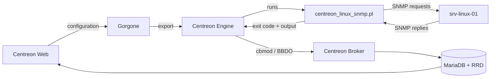

## Journey of a service check: CPU usage of a Linux server

This topic follows a single service check from the moment you configure it in Centreon Web to the moment its result is displayed. It uses the CPU check of the Linux SNMP Monitoring Connector as an example.
<!-- , and explains where Centreon connectors come into play. -->

The steps where the Monitoring Connector is involved are marked **From the Monitoring Connector**. The other steps are handled by Centreon's own components.


## Example used in this topic

| Item | Value |
|------|-------|
| Monitoring Connector | Linux SNMP |
| Host | `srv-linux-01` (`192.168.1.20`) |
| Host template | `OS-Linux-SNMP-custom` |
| SNMP version and community | `2c` / `public` |
| Service | `Cpu` |
| Service template | `OS-Linux-Cpu-SNMP-custom` |
| Command | `OS-Linux-SNMP-Cpu` |
| Plugin | `centreon_linux_snmp.pl`, `cpu` mode |
| Check interval | 5 minutes |

> **Note:** Command names, macros and thresholds depend on your Monitoring Connector version. The values below are typical examples.

## Overview



## Step 1: Declare the check

In Centreon Web, create the host `srv-linux-01` (`192.168.1.20`) with the host template `OS-Linux-SNMP-custom`, and enter its SNMP version (`2c`) and community (`public`). If you check **Create Services linked to the Template too**, the `Cpu` service is created automatically with the service template `OS-Linux-Cpu-SNMP-custom`.

The service template uses the `OS-Linux-SNMP-Cpu` command (simplified):

```text
$CENTREONPLUGINS$/centreon_linux_snmp.pl --plugin=os::linux::snmp::plugin --mode=cpu \
  --hostname=$HOSTADDRESS$ --snmp-version='$_HOSTSNMPVERSION$' \
  --snmp-community='$_HOSTSNMPCOMMUNITY$' $_HOSTSNMPEXTRAOPTIONS$ \
  --warning-average='$_SERVICEWARNING$' --critical-average='$_SERVICECRITICAL$' \
  $_SERVICEEXTRAOPTIONS$
```

Service macros, with their default values:

```text
WARNING=80
CRITICAL=90
```

> **From the Monitoring Connector:** you don't write this command yourself. The host template, the service template, the command and the default thresholds all come with the Monitoring Connector. You only adjust the values you need, such as the SNMP community or the thresholds.

<!-- The command's **Connector** field is empty. See [Step 4](#step-4-engine-chooses-how-to-run-the-command) for why this matters. -->

## Step 2: Export the configuration

When you export the configuration, Gorgone generates the Centreon Engine configuration files, copies them to the poller that monitors `srv-linux-01`, and reloads Centreon Engine on that poller.

```text
define service {
  host_name            srv-linux-01
  service_description  Cpu
  check_command        OS-Linux-SNMP-Cpu
  check_interval       5
  max_check_attempts   3
}
```

## Step 3: Engine schedules the check and builds the command

Every 5 minutes, Centreon Engine runs the **Cpu** service. It replaces each macro with its real value to get a ready-to-run command line:

```text
/usr/lib/centreon/plugins/centreon_linux_snmp.pl --plugin=os::linux::snmp::plugin --mode=cpu \
  --hostname=192.168.1.20 --snmp-version='2c' --snmp-community='public' \
  --warning-average='80' --critical-average='90'
```

## Step 4: Engine runs the plugin

Centreon Engine starts a new process on the poller and runs `centreon_linux_snmp.pl` with this command line.

> **From the Monitoring Connector:** the plugin. It must be installed on the poller that runs the check. You can install it manually, or let Centreon install it automatically when you deploy the configuration, if **Automatic installation of plugins** is set to **ON** on the **Configuration > Connectors > Monitoring Connectors** page.

<!--
## Step 4: Engine chooses how to run the command

This is where a connector would come into play.

Centreon Engine checks whether a connector is defined for the command. Here, none is defined, so Engine forks a new process and runs `check_icmp` directly.

This is the right choice for a ping: `check_icmp` is a small compiled C program that starts in a few milliseconds, so a connector would bring no benefit.

Connectors matter for Perl plugins and SSH checks, where starting from scratch on every check is expensive. See [The role of the connector](#the-role-of-the-connector).
-->

## Step 5: The plugin queries the server

The plugin sends SNMP requests to `192.168.1.20` on UDP port 161, and reads the CPU usage of each core. The SNMP agent of `srv-linux-01` answers: it must be configured to accept requests from the poller with the `public` community.

```text
poller → SNMP get CPU usage per core → 192.168.1.20:161
poller ← core 0: 10 %, core 1: 15 %
computed: average 12.50 %
```

## Step 6: The plugin returns its result

The plugin compares the average CPU usage with the thresholds (warning at 80%, critical at 90%) and exits. Centreon Engine reads:

- the **exit code**: `0` (OK), `1` (WARNING), `2` (CRITICAL) or `3` (UNKNOWN)
- the **output**: the text before the `|` character
- the **performance data**: the text after the `|` character

```text
exit code: 0

OK: 2 CPU(s) average usage is 12.50 % | 'cpu.utilization.percentage'=12.50%;0:80;0:90;0;100 '0#core.cpu.utilization.percentage'=10.00%;;;0;100 '1#core.cpu.utilization.percentage'=15.00%;;;0;100
```

> **From the Monitoring Connector:** the plugin defines what is measured, the wording of the output and the names of the metrics (here, `cpu.utilization.percentage` and `core.cpu.utilization.percentage`). The connector's templates are built around these metrics: their macros set the thresholds that the plugin compares the measurements with. The metrics of each service are listed in the connector's monitoring procedure.

## Step 7: Engine determines the state

Exit code `0` means OK, so no further action is taken.

If the average CPU usage went over 90%, the plugin would return `2` (CRITICAL). Centreon Engine would set a **soft** CRITICAL state and retry the check up to `max_check_attempts` times (3 in this example). Only if all attempts fail does the state become **hard** CRITICAL and trigger notifications.

## Step 8: The result is sent to the central server

The broker module loaded in Centreon Engine (cbmod) converts the result into an event and streams it over the BBDO protocol (TCP port 5669) to Centreon Broker on the central server.

```text
service_status  host=srv-linux-01  service=Cpu
state=OK
output="OK: 2 CPU(s) average usage is 12.50 %"
perfdata="'cpu.utilization.percentage'=12.50%;0:80;0:90;0;100 ..."
```

## Step 9: Centreon Broker stores the result

Centreon Broker:

- writes the real-time status to the MariaDB database (`centreon_storage`)
- sends the metrics (`cpu.utilization.percentage` and one `core.cpu.utilization.percentage` metric per core) to RRD files, which are used to draw graphs

## Step 10: The result is displayed

In **Monitoring > Resources Status**, the **Cpu** service of `srv-linux-01` is displayed as **OK** with its output, and the performance graph gets new data points.

Five minutes later, Centreon Engine starts again at [Step 3](#step-3-engine-schedules-the-check-and-builds-the-command).

<!--
## The role of the connector

A connector is a long-lived process running on the poller. When a command is linked to a connector, Centreon Engine doesn't start a new process for each check: it sends the command line to the connector, which runs it and returns the result.

Centreon provides two connectors:

| Connector | What it keeps in memory | Benefit |
|-----------|-------------------------|---------|
| Centreon Connector Perl | A running Perl interpreter and compiled plugin code | No interpreter startup or code compilation on each check |
| Centreon Connector SSH | Open SSH sessions to monitored hosts | No new SSH connection and handshake on each check |

Comparison for a single check:

| Type of check | Without connector | With connector |
|---------------|-------------------|----------------|
| Ping (`check_icmp`, compiled C) | Fork, run binary | Not applicable |
| Perl plugin (`centreon_plugins.pl`) | Fork, start Perl, compile plugin, run | Run cached code |
| SSH check | Fork, open SSH session, authenticate, run | Run in existing session |

On pollers that run thousands of Perl or SSH checks, connectors significantly reduce CPU load and check latency. To use one, select it in the **Connector** field of the command definition.
-->
