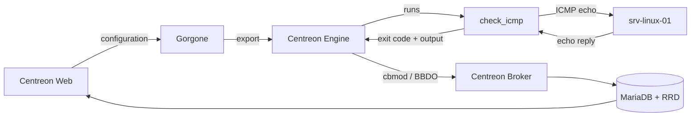

## Journey of a service check: a ping on a Linux server

This topic follows a single service check from the moment you configure it in Centreon Web to the moment its result is displayed. It uses a ping on a Linux server as an example.
<!-- , and explains where Centreon connectors come into play. -->


## Example used in this topic

| Item | Value |
|------|-------|
| Host | `srv-linux-01` |
| IP address | `192.168.1.20` |
| Service | `Ping` |
| Command | `check_centreon_ping` |
| Plugin | `check_icmp` |
| Check interval | 5 minutes |

> **Note:** Plugin paths, macros and thresholds depend on your Monitoring Connector version and operating system. The values below are typical examples.

## Overview



## Step 1: Declare the check

In Centreon Web, create the host `srv-linux-01` (`192.168.1.20`) and attach a **Ping** service to it. The service uses the `check_centreon_ping` command:

```text
$USER1$/check_icmp -H $HOSTADDRESS$ -n $_SERVICEPACKETNUMBER$ \
  -w $_SERVICEWARNING$ -c $_SERVICECRITICAL$
```

Service macros:

```text
PACKETNUMBER=5
WARNING=200,20%
CRITICAL=400,50%
```

<!-- The command's **Connector** field is empty. See [Step 4](#step-4-engine-chooses-how-to-run-the-command) for why this matters. -->

## Step 2: Export the configuration

When you export the configuration, Gorgone generates the Centreon Engine configuration files, copies them to the poller that monitors `srv-linux-01`, and reloads Centreon Engine on that poller.

```text
define service {
  host_name            srv-linux-01
  service_description  Ping
  check_command        check_centreon_ping
  check_interval       5
  max_check_attempts   3
}
```

## Step 3: Engine schedules the check and builds the command

Every 5 minutes, Centreon Engine runs the **Ping** service. It replaces each macro with its real value to get a ready-to-run command line:

```text
/usr/lib/nagios/plugins/check_icmp -H 192.168.1.20 -n 5 -w 200,20% -c 400,50%
```

## Step 4: Engine runs the plugin

Centreon Engine starts a new process on the poller and runs `check_icmp` with this command line.

<!--
## Step 4: Engine chooses how to run the command

This is where a connector would come into play.

Centreon Engine checks whether a connector is defined for the command. Here, none is defined, so Engine forks a new process and runs `check_icmp` directly.

This is the right choice for a ping: `check_icmp` is a small compiled C program that starts in a few milliseconds, so a connector would bring no benefit.

Connectors matter for Perl plugins and SSH checks, where starting from scratch on every check is expensive. See [The role of the connector](#the-role-of-the-connector).
-->

## Step 5: The plugin pings the server

`check_icmp` sends 5 ICMP echo requests to `192.168.1.20` and measures the response time of each reply. The Linux kernel on `srv-linux-01` answers on its own: no agent or software needs to be installed on the monitored server.

```text
poller → echo request → 192.168.1.20   (x5)
poller ← echo reply   ← 192.168.1.20
measured: rta 0.42 ms, 0% packet loss
```

## Step 6: The plugin returns its result

`check_icmp` compares the measurements with the thresholds (warning at 200 ms or 20% packet loss, critical at 400 ms or 50%) and exits. Centreon Engine reads:

- the **exit code**: `0` (OK), `1` (WARNING), `2` (CRITICAL) or `3` (UNKNOWN)
- the **output**: the text before the `|` character
- the **performance data**: the text after the `|` character

```text
exit code: 0

OK - 192.168.1.20 rta 0.420ms lost 0%|rta=0.420ms;200.000;400.000;0; pl=0%;20;50;0;
```

## Step 7: Engine determines the state

Exit code `0` means OK, so no further action is taken.

If the server stopped answering, the plugin would return `2` (CRITICAL). Centreon Engine would set a **soft** CRITICAL state and retry the check up to `max_check_attempts` times (3 in this example). Only if all attempts fail does the state become **hard** CRITICAL and trigger notifications.

## Step 8: The result is sent to the central server

The broker module loaded in Centreon Engine (cbmod) converts the result into an event and streams it over the BBDO protocol (TCP port 5669) to Centreon Broker on the central server.

```text
service_status  host=srv-linux-01  service=Ping
state=OK
output="OK - 192.168.1.20 rta 0.420ms lost 0%"
perfdata="rta=0.420ms;200.000;400.000;0; pl=0%;20;50;0;"
```

## Step 9: Centreon Broker stores the result

Centreon Broker:

- writes the real-time status to the MariaDB database (`centreon_storage`)
- sends the metrics (`rta` and `pl`) to RRD files, which are used to draw graphs

## Step 10: The result is displayed

In **Monitoring > Resources Status**, the **Ping** service of `srv-linux-01` is displayed as **OK** with its output, and the performance graph gets a new `rta` data point.

Five minutes later, Centreon Engine starts again at [Step 3](#step-3-engine-schedules-the-check-and-builds-the-command).

<!--
## The role of the connector

A connector is a long-lived process running on the poller. When a command is linked to a connector, Centreon Engine doesn't start a new process for each check: it sends the command line to the connector, which runs it and returns the result.

Centreon provides two connectors:

| Connector | What it keeps in memory | Benefit |
|-----------|-------------------------|---------|
| Centreon Connector Perl | A running Perl interpreter and compiled plugin code | No interpreter startup or code compilation on each check |
| Centreon Connector SSH | Open SSH sessions to monitored hosts | No new SSH connection and handshake on each check |

Comparison for a single check:

| Type of check | Without connector | With connector |
|---------------|-------------------|----------------|
| Ping (`check_icmp`, compiled C) | Fork, run binary | Not applicable |
| Perl plugin (`centreon_plugins.pl`) | Fork, start Perl, compile plugin, run | Run cached code |
| SSH check | Fork, open SSH session, authenticate, run | Run in existing session |

On pollers that run thousands of Perl or SSH checks, connectors significantly reduce CPU load and check latency. To use one, select it in the **Connector** field of the command definition.
-->