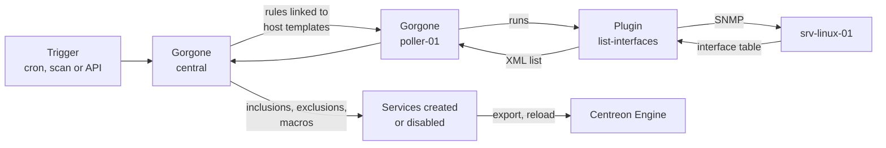

## Journey of a service discovery: finding network interfaces on a Linux server

This topic follows a service discovery from its trigger to the moment the discovered services are monitored. It uses the discovery of network interfaces on a Linux server as an example.

It follows on from [Journey of a discovery job](journey-of-a-discovery-job.md): the host `srv-linux-01` has been created with the host template `OS-Linux-SNMP-custom`.

## Example used in this topic

| Item | Value |
|------|-------|
| Host | `srv-linux-01` (`192.168.1.20`) |
| Host template | `OS-Linux-SNMP-custom` |
| Discovery rule | `OS-Linux-SNMP-Traffic-Name` |
| Discovery mode | `list-interfaces` |
| Service template applied | `OS-Linux-Traffic-Generic-Name-SNMP-custom` |
| Services created | `Traffic-eth0`, `Traffic-eth1` |

> **Note:** Rule names, service templates, macros and XML attributes depend on your Monitoring Connector version. The commands and outputs below are simplified examples.

## Host discovery and service discovery

Host discovery and service discovery are two different mechanisms of the Auto Discovery module:

- **Host discovery** uses **jobs**: it scans a network, a cloud account or a hypervisor to find hosts.
- **Service discovery** uses **rules**: it looks *inside* hosts that already exist to find items to monitor, such as network interfaces, disks or file systems, and creates one service per item.

## Overview



## Step 1: The rule is defined

Discovery rules are listed in **Configuration > Services > Rules**. Most Monitoring Connectors provide ready-made rules. The rule used here contains:

| Setting | Value in this example | Purpose |
|---------|----------------------|---------|
| Command Macro | `OS-Linux-SNMP-Traffic-Name` | Command used to enumerate the items |
| Command Discover | `os-linux-snmp-list-interfaces` | Command that lists items on the host |
| Service template | `OS-Linux-Traffic-Generic-Name-SNMP-custom` | Template used for each new service |
| Service display name | `Traffic-$name$` | Name of each new service, built from an XML attribute |
| Host templates | `OS-Linux-SNMP-custom` | The rule applies to every host using this template |
| Disable elements not found | Enabled | Disables services whose item disappeared |
| Update existing services | Enabled | Updates macros of services already created |
| Contact groups | `Supervisors` | Notified when services are created or disabled |
| Activate | Enabled | Inactive rules are ignored |

Because `srv-linux-01` uses `OS-Linux-SNMP-custom`, this rule applies to it with no extra configuration.

## Step 2: The discovery is triggered

A service discovery can start in three ways:

- **Scheduled**: Gorgone's cron module runs all active rules periodically. By default, every day at 10:30 PM, as defined in `/etc/centreon-gorgone/config.d/cron.d/41-service-discovery.yaml`:

  ```yaml
  - id: service_discovery
    timespec: "30 22 * * *"
    action: LAUNCHSERVICEDISCOVERY
  ```

- **Manual scan**: in **Configuration > Services > Scan**, select a host and run the discovery to see and choose the results.
- **API**: send a request to the Gorgone API, optionally filtered by rule, host or poller. Use `dry_run` to test without changing the configuration:

  ```bash
  curl --request POST "http://localhost:8085/api/centreon/autodiscovery/services" \
    --header "Content-Type: application/json" \
    --data '{"filter_rules": ["OS-Linux-SNMP-Traffic-Name"], "filter_hosts": ["srv-linux-01"], "dry_run": 1}'
  ```

## Step 3: Gorgone finds which hosts and rules to run

Gorgone on the central server lists the active rules, then the hosts that use the host templates linked to each rule. Here, it finds that `OS-Linux-SNMP-Traffic-Name` must run on `srv-linux-01`.

Gorgone resolves the rule's command with the host's values (address, SNMP community, macros) and sends it to Gorgone on the poller that monitors the host, `poller-01`.

## Step 4: The poller runs the discovery plugin

Gorgone on `poller-01` runs the plugin in a `list-` mode with the `--disco-show` option:

```text
/usr/lib/centreon/plugins/centreon_linux_snmp.pl --mode=list-interfaces \
  --hostname=192.168.1.20 --snmp-version=2c --snmp-community=public --disco-show
```

## Step 5: The plugin reads the server's interfaces

The plugin queries the interface table of `srv-linux-01` over SNMP and gets every interface with its name, status and speed.

```text
poller-01 → SNMP walk interface table → 192.168.1.20
poller-01 ← lo   (up)
poller-01 ← eth0 (up, 1000 Mb/s)
poller-01 ← eth1 (up, 1000 Mb/s)
poller-01 ← eth2 (down)
```

## Step 6: The plugin returns an XML list

With `--disco-show`, the plugin returns one XML element per item. Each piece of information is an XML attribute:

```xml
<?xml version="1.0" encoding="utf-8"?>
<data>
  <label name="lo" status="up" total="10" interfaceid="1"/>
  <label name="eth0" status="up" total="1000" interfaceid="2"/>
  <label name="eth1" status="up" total="1000" interfaceid="3"/>
  <label name="eth2" status="down" total="1000" interfaceid="4"/>
</data>
```

To know which attributes a mode returns, run it with `--disco-format` instead of `--disco-show`. The same attributes are shown in the rule's **Inclusions / Exclusions & Macros** tab.

Gorgone on the poller sends the list back to Gorgone on the central server.

## Step 7: Inclusions and exclusions filter the list

The rule's inclusions and exclusions are applied to the XML attributes:

| Rule | Attribute | Value | Effect |
|------|-----------|-------|--------|
| Exclusion | `name` | `^lo$` | `lo` is removed |
| Inclusion | `status` | `up` | `eth2` is removed |

Two items remain: `eth0` and `eth1`.

## Step 8: Each item becomes a service

For each remaining item, the rule builds a service:

- **Name**: `Traffic-$name$` gives `Traffic-eth0` and `Traffic-eth1`.
- **Template**: `OS-Linux-Traffic-Generic-Name-SNMP-custom`.
- **Macros**: XML attributes are mapped to service macros. For example, `name` fills the `INTERFACENAME` macro, so `Traffic-eth0` monitors `eth0`.

The services are created on `srv-linux-01`. Items already in the configuration are skipped, or updated if **Update existing services** is enabled.

With a manual scan, nothing is created until you select the items and save.

## Step 9: Missing items are disabled

**Disable elements not found** is enabled, so Gorgone compares the discovered items with the services created by this rule on previous runs. If an interface has disappeared, its service is disabled.

The **Supervisors** contact group receives an email listing the services created and disabled.

## Step 10: The configuration is deployed

The poller configuration is exported and Centreon Engine on `poller-01` is reloaded. `Traffic-eth0` and `Traffic-eth1` are now scheduled like any other service.

From here, each check follows the journey described in [Journey of a check](journey-of-a-check.md). These traffic checks use a Perl plugin, so they benefit from Centreon Connector Perl if the command is linked to it.

## Host discovery versus service discovery

| | Host discovery | Service discovery |
|---|---|---|
| Configured as | Jobs (**Configuration > Hosts > Discovery**) | Rules (**Configuration > Services > Rules**) |
| Scope | A network, account or platform | Hosts using the rule's host templates |
| Triggered by | Job schedule or **Force execution** | Gorgone cron (daily by default), manual scan or API |
| Run by | Gorgone | Gorgone |
| Plugin output | JSON | XML (`--disco-show`) |
| Results turned into objects by | Mappers | Inclusions, exclusions and macros |
| Creates | Hosts (and their template services) | Services on existing hosts |
| Removes what's gone | No (only excluded hosts can be disabled) | Yes, with **Disable elements not found** |

## Behavior to keep in mind

- A rule only runs on hosts whose host templates are linked to it. If a host is missing from the results, check its templates first.
- A rule must be activated to run from the cron or the API.
- If you rename the services a rule creates (by changing **Service display name**), the next run creates new services instead of matching the old ones, which leads to duplicates.
- Test changes with a manual scan or the API's `dry_run` option before letting the scheduled run apply them.