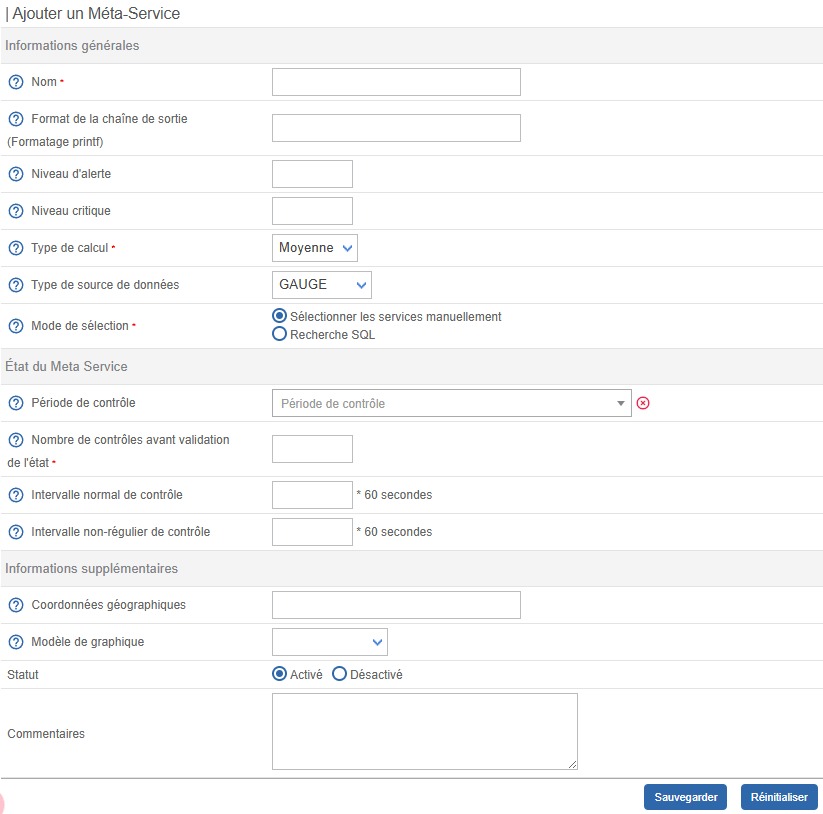
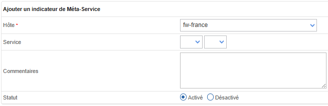

## Définition

Un métaservice est un service virtuel permettant l’agrégation de métriques issues de différents services au travers
d’une opération mathématique. Les métaservices sont gérés de la même manière qu’un service c’est à dire qu’ils
possèdent des seuils, un processus de notification, génèrent un graphique de performance...

Exemple : Il est possible de déterminer la consommation totale de trafic WAN en additionnant au sein d’un métaservice
l’ensemble des services supervisant le trafic WAN unitairement.

### Les types de calcul

Plusieurs types de calculs sont possibles sur les métriques récupérées :

* **Average** : réalise la moyenne des données de performances
* **Somme** : réalise la somme des données de performances
* **Minimum** : récupère le minimum de l’ensemble des données de performances
* **Maximum** : récupère le maximum de l’ensemble des données de performances

### Les types de sources de données

Le résultat du calcul est une donnée de performance (métrique) qui génèrera un graphique de performance. Afin de tracer
au mieux le résultat, il faut sélectionner le type de source de données (par défaut GAUGE). Les types de sources de
données disponibles sont :

* Le type **GAUGE** enregistre une valeur instantanée (température, humidité, CPU, ...)
* Le type **COUNTER** enregistre une valeur incrémentale par rapport au résultat précédent
* Le type **DERIVE** stockera la dérivée de la ligne allant de la dernière à la valeur courante de la source de données.
  Cela peut être utile pour des jauges, par exemple, de mesurer le taux de personnes entrant ou quittant une pièce.
* Le type **ABSOLUTE** est pour les compteurs qui se réinitialisent à la lecture. Il est utilisé pour les compteurs
  rapides qui ont tendance à déborder.

> Plus d’informations sur le site de *[RRDTools](http://oss.oetiker.ch/rrdtool/doc/rrdcreate.en)*.

## Configuration

Pour ajouter un métaservice :

Rendez-vous dans le menu : **Configuration > Services > Métaservices** et cliquez sur le bouton **Ajouter**

### Informations générales

* Le champ **Nom** correspond au nom du métaservice affiché dans l’interface. Les caractères suivants ne sont pas autorisés : `~!$%^&|'"<>?,()=*{}` et les espaces.
* Le champ **Format de la chaîne de sortie (Formatage printf)** correspond au message de sortie (‘output’) visible dans Centreon.
  La valeur “%d” correspond à la valeur calculée par le métaservice.
* Le champ **Niveau d'alerte** and **Niveau critique** correspondent respectivement aux seuils "WARNING" et "CRITICAL" du métaservice.
* Les champs **Type de calcul** et **Type de source de données** correspondent respectivement aux calculs et à la description
  de la source de données
* Le champ **Mode de sélection** permet de sélectionner les services contenant les métriques qui entreront dans le calcul du métaservice.

Si l'option **Sélectionner les services manuellement** est sélectionnée alors les métriques choisies seront issues de services sélectionnés
manuellement.

Si l’option **Recherche SQL**  est sélectionnée alors les services utilisés seront sélectionnés automatiquement par
Centreon via une recherche à partir du champ Expression SQL à rechercher de type LIKE. La métrique à utiliser sera dans
ce cas à sélectionner dans la liste déroulante Métrique.

> Plus d’informations sur le formatage *[PRINTF](http://en.wikipedia.org/wiki/Printf_format_string)*.

### État du Métaservice

* Le champ **Période de contrôle** définit la période temporelle durant laquelle l’ordonnanceur vérifie le statut du métaservice.
* Le champ **Nombre de contrôles avant validation de l'état** définit le nombre de contrôles à effectuer avant de valider le statut du métaservice
  : lorsque le statut est validé, une notification est envoyée.
* Le champ **Intervalle normal de contrôle** est exprimé en minutes. Il définit l’intervalle entre chaque vérification lorsque
  le statut du métaservice est OK.
* Le champ **Intervalle non-régulier de contrôle** est exprimé en minutes. Il définit l’intervalle de validation du statut non-OK du
  métaservice.

### Informations supplémentaires

* La liste **Modèle de graphique** définit le modèle de graphique utilisé par ce métaservice.
* Les champs **Statut** et **Commentaires** permettent d’activer / désactiver ou de commenter le métaservice.

## Sélectionner manuellement des services

Si vous avez choisi l’option **Sélectionner les services manuellement**, au sein de l’écran regroupant l’ensemble des métaservices :

1. Cliquez sur suivant pour sélectionner les métriques entrant en jeu dans le calcul du métaservice. Ces métriques
  sont appelées indicateurs. 
2. Cliquez sur le bouton **Ajouter**

* Le champ **Hôte** permet de sélectionner l’hôte auquel le service à sélectionner appartient.
* Le champ **Service** permet de choisir le service (première liste) ainsi que la métrique au sein de ce service
  (seconde liste).
* Les champs **Statut** et **Commentaires** permettent d’activer / désactiver ou de commenter l’indicateur.

3. Répétez l’opération jusqu’à avoir ajouté tous les indicateurs nécessaires au calcul du métaservice.

> Un métaservice est à considérer comme service régulier. Il est nécessaire de générer la configuration de
> l’ordonnanceur central, d’exporter cette dernière puis de redémarrer l’ordonnanceur.
