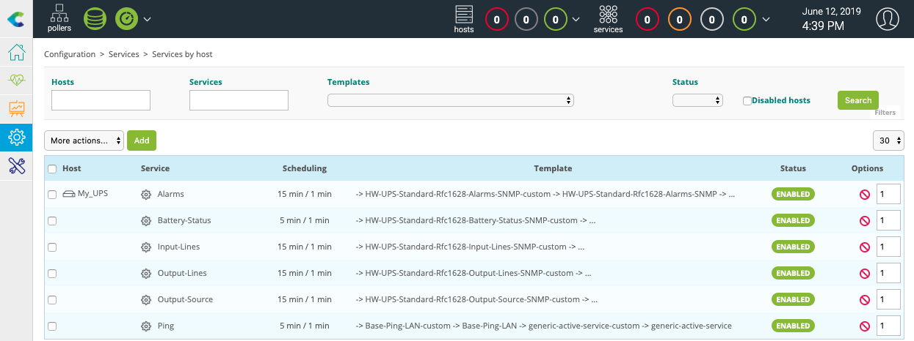

Go to the **Configuration > Connectors > Monitoring Connectors** menu, search for **UPS Standard**, then click the **+** icon on the Monitoring Connector's tile to install it.

Go to the **Configuration \> Hosts \> Hosts** menu and click **Add**.

Input the following information:

* **Name**: the name of the server
* **Alias**: a description of the server
* **Address**: the IP address
* **SNMP Community & Version**: the SNMP version and community

Click on **+ Add a new entry** button in **Templates** field, then select the **HW-UPS-Standard-Rfc1628-SNMP-custom**
template in the list.

Click **Save**.

Your device has been added to the list of hosts in **Configuration > Hosts > Hosts**.

Go to the **Configuration \> Services \> Services by host** menu. A set of indicators has been automatically deployed:

It is now time to [deploy the configuration](first-supervision.md#deploying-a-configuration).

Then go to **Monitoring > Resources Status** and select **All** from the **Resource status** filter. After a few minutes, the first results of the monitoring appear.