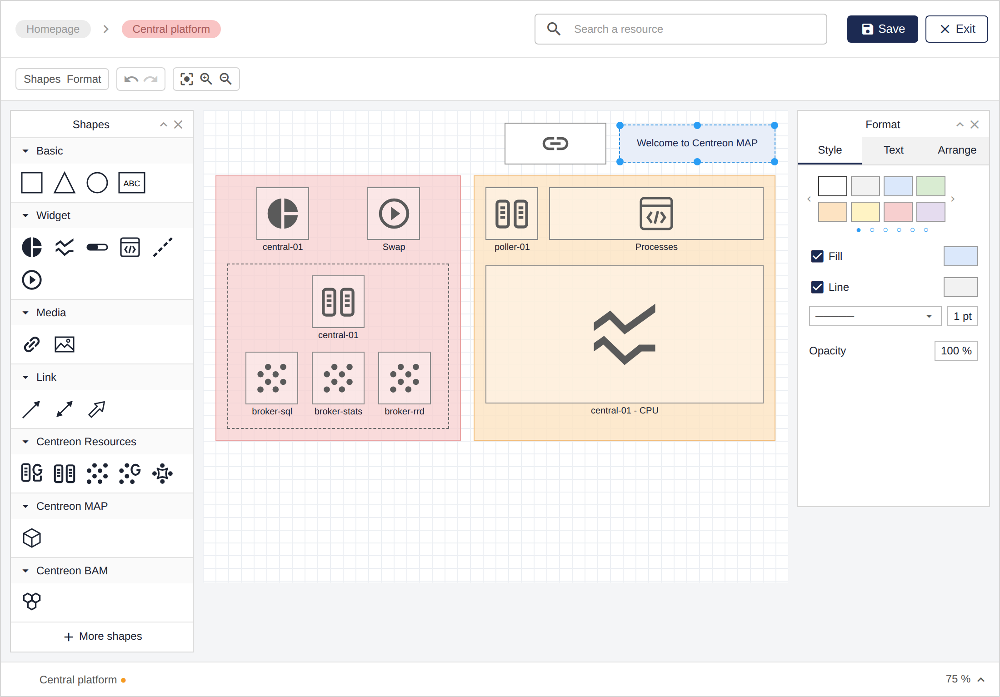

Centreon MAP lets you create, view and share graphical representations of your monitored infrastructure, directly in the Centreon web interface.

> Centreon MAP is a Centreon extension that requires a valid [license](../administration/licenses.md). To purchase one and retrieve the necessary repositories, contact [Centreon](mailto:sales@centreon.com).

> From Centreon 24.10, MAP Legacy is no longer available. Whether you were still using MAP Legacy or not, see [MAP Legacy end of life](https://docs.centreon.com/docs/24.10/graph-views/map-legacy-eol/).

> To manage maps using the Centreon MAP REST API, see [Automating MAP via API](../api/map-api.md).

## Overview

Create, customize, and display your maps within a single web interface.

First, create your maps in the MAP editor:

Then display your map in viewing mode:

Your maps can be displayed in two ways in the interface:
- On the **Monitoring > Map** page, in viewing mode.
- On the **Home > Custom Views** page, using a dedicated MAP [widget](../alerts-notifications/custom-views.md).

## Procedures

The following topics explain how to use and administer Centreon MAP.

### Administrating MAP
  - [Installing MAP](map-web-install.md) describes prerequisites and procedures to install MAP.
  - [Installing MAP on a remote server](map-web-install-remote.md) explains how to install MAP on a remote server.
  - [Updating MAP](map-web-update.md) describes the update process for MAP.
  - [Managing access rights in MAP](map-web-access.md) describes the various rights and permissions on maps.
  
### Using MAP
  - [Best practices for using maps](map-best-practices.md) gives tips to build clear maps that are easy to maintain.
  - [Managing maps in MAP](map-web-manage.md) explains how to manage maps from the Centreon MAP interface.
  - [Creating a standard map](map-web-create-standard-map.md) describes how to create standard maps and how to customize them using the MAP editor.
  - [Creating a geographic view](map-web-create-geoview.md) explains how to display your resources across a defined geographical area.
  - [MAP known issues](map-web-known-issues.md) lists issues you may encounter when using MAP.
  - [MAP troubleshooting](map-web-troubleshooting.md) helps you to solve some issues occurring in MAP.
